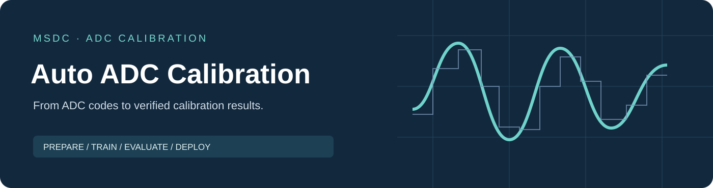

# Auto ADC Calibration

**自动化 ADC 神经网络数字校准工作台**

[English](README.md) · [安装](docs/installation.zh-CN.md) · [图解教程](docs/quick-start.zh-CN.md) · [使用手册](docs/user-guide.zh-CN.md)

从原始 ADC 码字出发，完成数据预处理、神经网络训练和独立测试，并按需继续剪枝、量化与硬件评估。通过统一项目管理保存模型、配置和结果，便于比较与复查。

## 开始使用

1. 从[官方 Releases](https://github.com/UESTC-MSDC/auto-adc-calibration/releases)获取完整 Windows 软件包，并阅读对应版本的发行说明。
2. 按[安装说明](docs/installation.zh-CN.md)完整解压，运行 `KAN Workbench.exe`。
3. 用[合成演示数据](examples/README.md)完成一次“数据预处理 → 浮点训练 → 模型测试”。

本仓库提供软件发行说明和使用文档。GitHub 的 **Source code (zip / tar.gz)** 是文档仓库快照；软件请下载 Releases 中的 Windows 发行附件。

## 工作流程

| 阶段 | 你可以完成什么 | 查看什么结果 |
| --- | --- | --- |
| 数据预处理 | 选择采集文件，配置 ADC 与数据格式 | 数据检查、训练与测试划分 |
| 浮点训练 / 模型搜索 | 训练补偿模型，或按目标搜索模型配置 | 训练曲线、模型及验收状态 |
| 模型测试 | 用原始采集测试冻结模型 | 校准前后频谱、逐组 SNDR / SFDR |
| 剪枝 / 量化 | 准备更小模型或量化模型 | 验收状态和模型复测结果 |
| RTL / ASIC | 导出并验证兼容模型，使用外部工具做硬件评估 | 功能、面积、时序与活动功耗报告 |

硬件流程需要相应工具或可选扩展。支持范围见[硬件使用说明](docs/hardware.zh-CN.md)。模型格式受支持不等于精度或硬件验证已经通过。

## 按需要阅读

| 文档 | 用途 |
| --- | --- |
| [安装与运行](docs/installation.zh-CN.md) | 解压、启动、CPU/GPU 与可选工具 |
| [图解教程](docs/quick-start.zh-CN.md) | 跟着截图完成第一次操作 |
| [使用手册](docs/user-guide.zh-CN.md) | 简明操作、常用设置和结果查看 |
| [数据格式](docs/data-format.zh-CN.md) | 码字格式、目录、采样率与数据划分 |
| [故障排查](docs/troubleshooting.zh-CN.md) | 启动、数据、训练和硬件常见问题 |
| [升级与备份](docs/upgrade.zh-CN.md) | 保护旧项目、迁移和回退 |
| [版本记录](CHANGELOG.md) | 公开版本变化及已知限制 |

## 使用范围

允许个人非商业和非商业学术使用。商业用途及企业资助研究须取得单独书面授权，包括高校承担的企业资助项目。可分享官方链接；对外转发软件包、提供镜像或重新打包须另行授权。

完整条款见[软件使用许可](LICENSE.txt)。第三方组件保留各自许可证赋予的权利，见[第三方声明](THIRD_PARTY_NOTICES.md)。应用源码不公开；本软件不属于开源软件。

## 结果与研究边界

请保留独立测试数据，并记录采样率、读取范围、模型和配置。软件评估与合成样例不能代替真实 ADC 性能测量。RTL 功能验证、综合估计、物理评估与芯片实测具有不同证据范围。

## 作者与联系

Copyright © 2026 电子科技大学模数混合与SoC芯片设计中心（MSDC）

作者：陈梓函 · 授权与使用咨询：[644245542@qq.com](mailto:644245542@qq.com)

学术使用建议记录软件版本并引用本项目；机器可读引用信息见 [CITATION.cff](CITATION.cff)。
