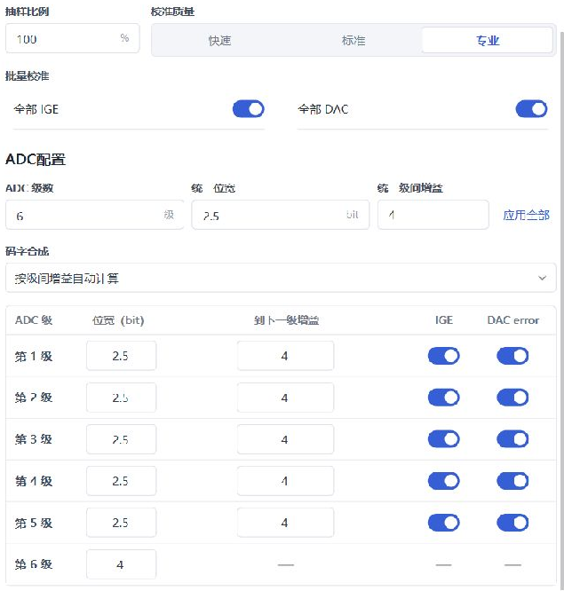
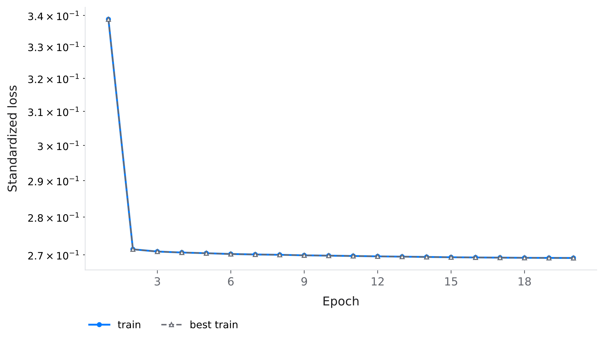
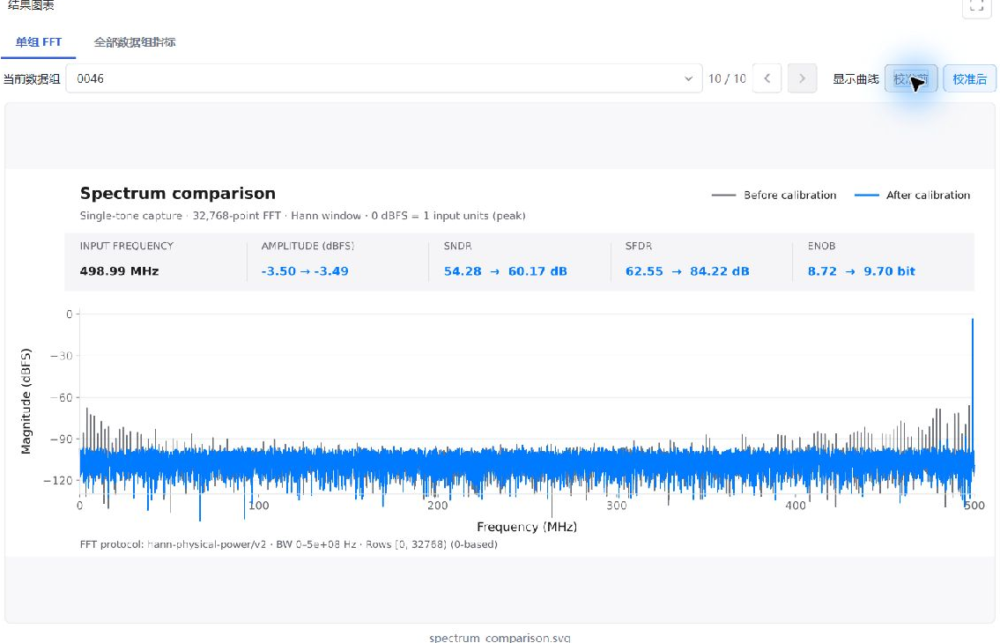
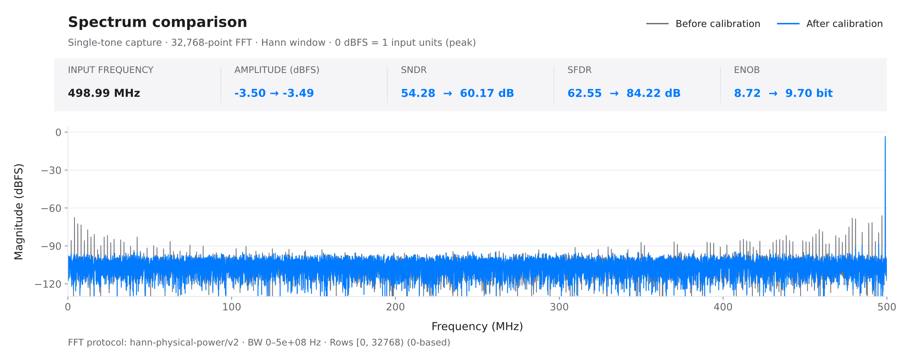
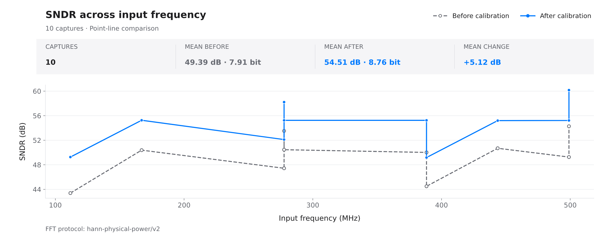
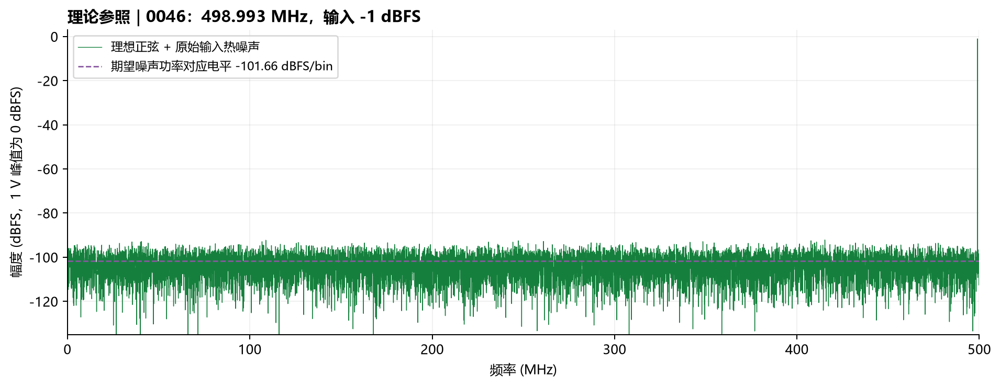

# Quick start: 50-capture full-band ADC calibration

[Installation](installation.md) · [User guide · 中文](user-guide.zh-CN.md) · [Configuration reference · 中文](reference.zh-CN.md) · [中文](quick-start.zh-CN.md)

Reproduce the completed **流水线ADC_全频段50组** experiment: **50 captures → 40/10 split → 18→5→1 KAN training → 10 held-out tests**. Settings, screenshots and results come from the saved October 20, 2026 experiment in Windows application 3.5.0. Chinese interface labels identify the controls below.

## 1. Prepare the application and data

Follow the [installation guide](installation.md), then run `KAN Workbench.exe`. Select **Code → Download ZIP** in this repository and extract **`examples/fullband50/raw/`**. These 50 CSV files accompany this guide; MATLAB is not required.

| Property | Specification |
| --- | --- |
| Captures | 10 frequencies × 5 amplitudes = 50 |
| Acquisition | Single channel, single tone, 1 GS/s, 32768 samples per capture |
| CSV structure | Six signed-integer columns; no header, timestamp or index column |
| Columns 1–5 | Five 2.5-bit pipeline stages; codes -4 to 4 |
| Column 6 | 4-bit backend; codes -8 to 7 |
| Nominal interstage gains | 4 for all five transitions |
| Input amplitudes | -1, -3, -6, -9 and -12 dBFS; 0 dBFS = 1 V peak |
| Input thermal noise | 5 LSB RMS, approximately 610.35 μV; LSB defined for 14 bits over ±1 V |

Frequencies are approximately **1.007, 56.366, 111.664, 167.023, 222.321, 277.679, 332.977, 388.336, 443.634 and 498.993 MHz**, spanning the interior of the 0–500 MHz first Nyquist zone. Each frequency has all five amplitudes. Exact coherent frequencies and hashes are in the [manifest](../examples/fullband50/manifest.json).

`PS_f498.993M_A-01.0dBFS_0046.csv` identifies capture 0046 at approximately 498.993 MHz and -1 dBFS. Its first three rows are:

```text
-4,2,-1,1,1,-3
4,-2,1,-1,0,1
-4,2,-1,1,-1,3
```

The simulation follows `generate_pipelined_single_tone.m`: fixed gain, DAC and comparator errors, cubic nonlinearity, memory, and random thermal noise added before quantization. Hardware errors remain fixed across captures. Jitter, temperature drift and device variation are not simulated. CSV files contain ADC codes without ideal-output labels.

## 2. Create a project and preprocess

Select **新建 / New**, then **编辑 / Edit** to name the project `流水线ADC_全频段50组`. Open **数据 / Data** and point **原始数据目录 / Raw data directory** to the supplied `raw` folder. A persistent copy such as `C:\ADC-Demo-Fullband-50\data` is also suitable.

| Interface field | Setting | Purpose |
| --- | --- | --- |
| 输出格式 / Output format | CSV | Store numeric outputs |
| 测试集比例 / Test fraction | **20%** | Reserve 10 complete captures; train on 40 |
| 输入编码 / Encoding | 有符号十进制 / Signed decimal | Interpret negative codes correctly |
| 通道数 / Channels; 输入信号 / Signal | 1; 单音 / Single tone | Match acquisition |
| 原始数据来源 / Source; 模型输入模式 / Model input | 各级码字 / Stage codes, both | Preserve six stage observations |
| 补偿基准来源 / Baseline source | **初始参数合成 / Nominal reconstruction** | Define the compensation baseline |
| 抽样比例 / Sample fraction; 校准质量 / Quality | 100%; 专业 / Professional | Match the recorded coarse calibration |
| 全部 IGE / All IGE; 全部 DAC / All DAC | **Enabled, both** | Estimate gain/DAC errors to improve the reference |

Set **ADC 级数 / Stage count = 6**; stage widths **2.5, 2.5, 2.5, 2.5, 2.5, 4**; and all five **到下一级增益 / Gains to the next stage = 4**. Select **按级间增益自动计算 / Compute from interstage gains**. Enter `4` in **统一级间增益**, select **应用全部**, and verify every row. The backend has no next-stage gain. Use nominal topology values, not the simulator's true mismatch parameters.



Select **1. 检查数据 / Check data → 2. 开始预处理 / Start preprocessing**. Verify **50 files, six columns, 40 training captures and 10 test captures**. To revise checked settings, select **重新开始 / Restart** first.

```text
project/outputs/preprocessing/v001/
├─ train_40/
│  ├─ inputs/       Normalized six-column inputs
│  ├─ baseline/     Nominal reconstructed baseline
│  └─ reference/    Sine reference fitted to coarse reconstruction
├─ test_10/         Preprocessed held-out captures
└─ raw_test/        Entry point for held-out raw-capture testing
```

Training targets are **`reference - baseline`**; calibrated outputs are **`baseline + predicted compensation`**. Although coarse calibration is enabled, the baseline remains nominal. Coarse calibration improves reference construction; the final result is not a KAN correction added to an already coarse-calibrated baseline.

`raw_test` may contain only `raw_sources.json`, referencing the original CSV files. Preserve the raw directory. A new random split can change capture allocation; training seed `1` does not fix preprocessing allocation. In this record, coarse fitting used 39 training-side captures and acceptance used one; none belonged to the final ten test captures.

## 3. Configure and train the KAN

Open **配置 / Configuration → 浮点模型 / Floating-point model → 模型训练 / Model training**. Verify that **训练数据 / Training data** points to this run's `train_40`.

| Tab / field | Setting | Reason |
| --- | --- | --- |
| 数据读取 / Data reading: input mode | 各级码字 / Stage codes | Six observations per sample |
| Sample rate; signal | 1 GHz; single tone | Match acquisition and spectral analysis |
| 每组读取行数 / Rows per capture | **32768** | Read each full capture |
| 网络设置 / Network: 窗口数量 / Window | **3** | Include temporal context for memory-related error |
| 隐藏层 / Hidden layers | **5** | One hidden layer; enter only `5` |
| grid; k | **5; 3** | Fit smooth nonlinearity with cubic splines over five grid intervals |
| 基础函数 / Base function | identity | Retain a linear branch |
| Independent KAN per output | Disabled | One output channel |

The preview should display **18→5→1, 1820 parameters**. Eighteen inputs correspond to six columns × three samples; the output is one compensation value. This is the completed configuration, not a proven minimum-size network.

Under **训练设置 / Training settings**, expand **训练策略 / Training strategy** and **运行设置 / Runtime settings**:

| Field | Setting |
| --- | --- |
| Epochs; batch size | **20; 512** |
| Learning rate; weight decay | **0.001; 0.0001** |
| Optimizer; loss | adamw; mse |
| 标准化补偿目标 / Normalize compensation targets | **Enabled** |
| Scheduler; cosine period; minimum learning rate | cosine; 20; 0.000001 |
| β1; β2; ε | 0.9; 0.999; 0.00000001 |
| AMSGrad; early stopping | Disabled, both |
| Device; precision | Auto; auto — resolved to CUDA and float64 in this run |
| Random seed | 1 |
| 评估记录 / Evaluation recording | Post-training evaluation and per-epoch spectra disabled |

Normalization scales compensation targets for optimization; cosine scheduling reduces late-stage updates, and weight decay lightly constrains parameters. Twenty epochs are the fixed budget; the loss need not approach zero.

Select **开始训练 / Start training**. Confirm the resolved device and precision on **训练 / Training**, then wait for **训练完成 / Complete, 20/20**. Recorded standardized MSE decreased from approximately **0.339 to 0.269**. **打开目录 / Open directory** locates `checkpoints/best.pt` and `last.pt`.



[View the original training-loss SVG](../assets/fullband50/training-loss.svg).

## 4. Test the ten held-out captures

Select **模型测试 / Model test** from the completed training page, or open **测试 / Test** and expand the input section.

1. **测试模型 / Test model:** select this run's `checkpoints/best.pt`. The recorded training version is `v002`; a first run usually uses `v001`. Match the task rather than a fixed version number.
2. **原始采集数据目录 / Raw capture directory:** select this preprocessing run's **`raw_test`**. Do not select `train_40`, `test_10` or the directory containing all 50 captures.
3. **Signal; rows per capture:** single tone; 32768. The model supplies the ADC contract and sample rate.
4. Select **开始测试 / Start test**. Verify **10 completed captures**.

In **单组 FFT / Single-capture FFT**, select a capture and enable **校准前 / Before** and **校准后 / After**. Use **全部数据组指标 / All-capture metrics** for SNDR and SFDR across the full set.



## 5. Interpret results and the noise reference

Before/after metrics use **32768 samples, a periodic Hann window, 1 GS/s and a 0–500 MHz band**. Check the fundamental's frequency and amplitude, then compare harmonics, spurs and noise. SNDR includes noise and distortion; SFDR measures the largest spur. ENOB is derived from the reported SNDR, not an increase in physical converter bits.



[View the original spectrum SVG](../assets/fullband50/capture_0046-spectrum.svg). Actual result plots come directly from the application; PNG copies are rasterized only for document layout.

All ten held-out results follow. Input amplitude refers to the simulator setting; metrics are in dB.

| Capture | MHz | Input dBFS | SNDR before → after | SFDR before → after |
| --- | ---: | ---: | ---: | ---: |
| 0015 | 111.664 | -12 | 43.39 → 49.26 | 48.62 → 73.58 |
| 0018 | 167.023 | -6 | 50.38 → 55.25 | 56.05 → 80.53 |
| 0027 | 277.679 | -3 | 53.52 → 58.21 | 60.70 → 86.62 |
| 0028 | 277.679 | -6 | 50.46 → 55.24 | 56.18 → 82.48 |
| 0029 | 277.679 | -9 | 47.43 → 52.11 | 55.12 → 78.96 |
| 0038 | 388.336 | -6 | 50.02 → 55.25 | 56.14 → 84.63 |
| 0040 | 388.336 | -12 | 44.50 → 49.18 | 50.29 → 79.17 |
| 0043 | 443.634 | -6 | 50.69 → 55.20 | 56.12 → 77.17 |
| 0046 | 498.993 | -1 | 54.28 → 60.17 | 62.55 → 84.22 |
| 0048 | 498.993 | -6 | 49.26 → 55.22 | 56.04 → 76.15 |

Mean SNDR is **49.39→54.51 dB**, with gains of **4.50–5.96 dB** per capture; SFDR gains are **20.12–28.89 dB**. Different amplitudes at the same frequency produce different SNRs: these points are not a constant-amplitude frequency sweep. See the [experiment record](../examples/fullband50/experiment.json) and [result CSV](../examples/fullband50/test-results.csv).



Original application exports: [SNDR](../assets/fullband50/sndr-vs-frequency.svg) · [SFDR](../assets/fullband50/sfdr-vs-frequency.svg).

### Calibration and the noise floor

Calibration suppresses repeatable conversion errors while preserving the input signal and random noise. A fitted sine reference provides a learning target; it does not make random input noise a recoverable deterministic error.

For input thermal noise alone, `SNR = 20 log10(A / (√2 σ))`, where `A` is sine peak amplitude and `σ = 610.35 μV RMS`. Reference SNRs at the five amplitudes are **60.28, 58.28, 55.28, 52.28 and 49.28 dB**, respectively. The -1 dBFS capture reaches 60.17 dB after calibration, close to this noise-limited reference. Further training-loss reductions need not improve held-out performance.



For this FFT convention, the expected noise-power-equivalent bin level is approximately **-101.66 dBFS/bin**; individual bins fluctuate. The theoretical plot uses **0 dBFS = 1 V peak**, without smoothing, filtering or noise subtraction. Application exports use normalized reconstructed codes, with magnitude readings approximately **2.50 dB lower**. Align references before comparing noise floors; SNDR/SFDR are invariant to a common fixed scale. See the [spectrum notes](../examples/fullband50/README.md).

### Scope of the result

Training/test files are disjoint, but frequency or amplitude conditions can overlap. This evaluates held-out captures from one device model; it does not establish generalization to every unseen frequency, other devices, or complete absence of overfitting. Further model or hyperparameter selection requires separate validation data and an independent final test set.

## 6. Preserve the experiment

Keep **raw captures, the complete project, model with its configuration, and test reports**. Raw files referenced by `raw_test` must remain accessible. See [backup and migration · 中文](user-guide.zh-CN.md#backup).

Completion criteria: **40/10 split; 20 completed epochs; ten test records; accessible model, metrics and spectra.** Use `test_summary.json`, `fft_summary.csv` and `groups/` for review. Match the model and test entry to their task versions on subsequent runs.
