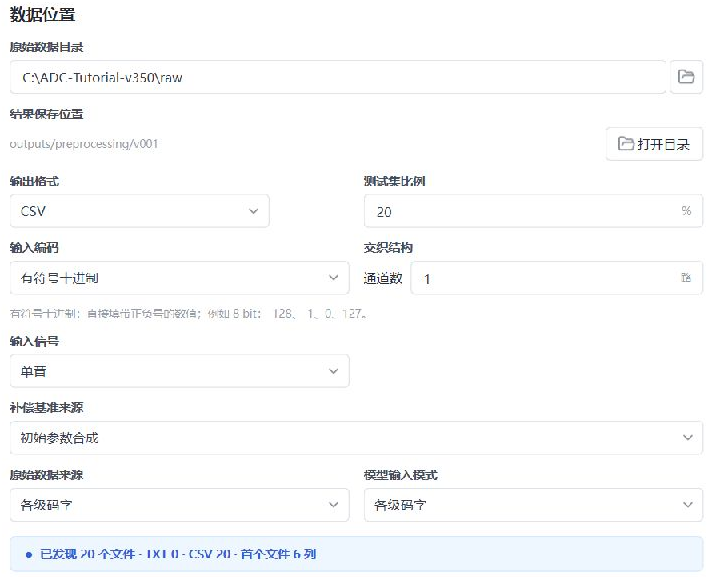
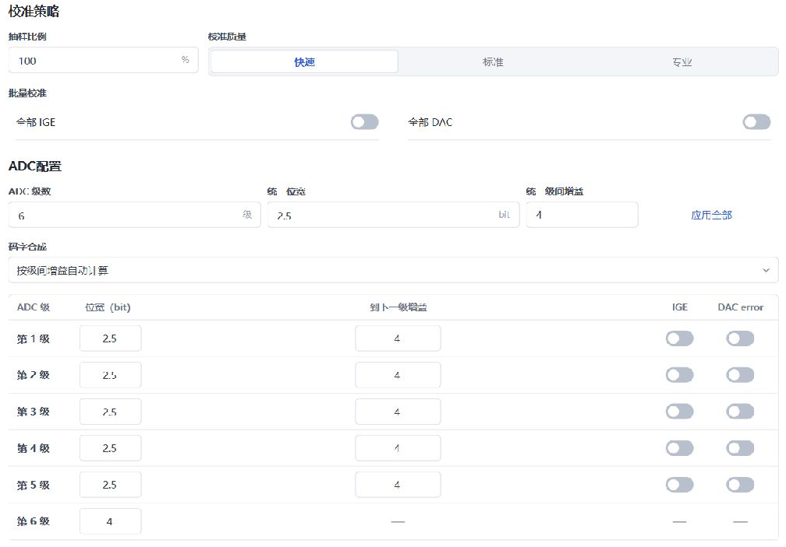
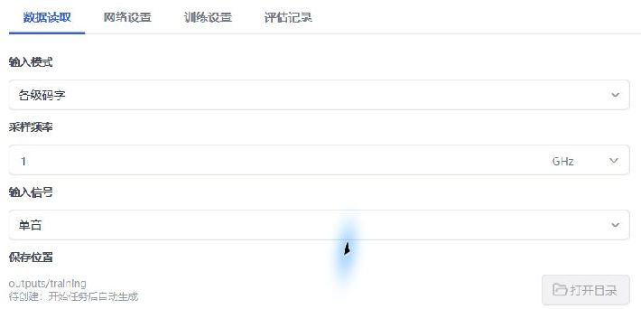
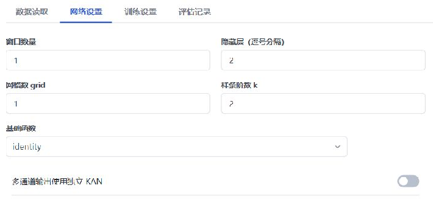
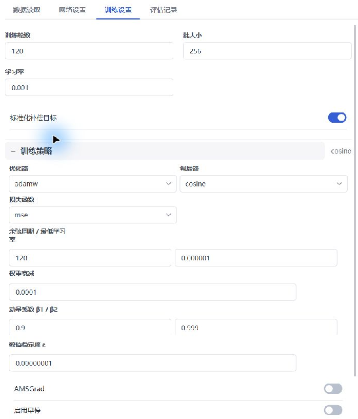
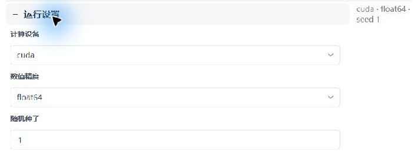
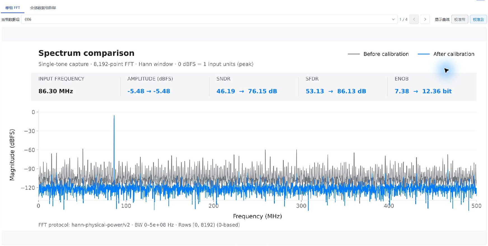
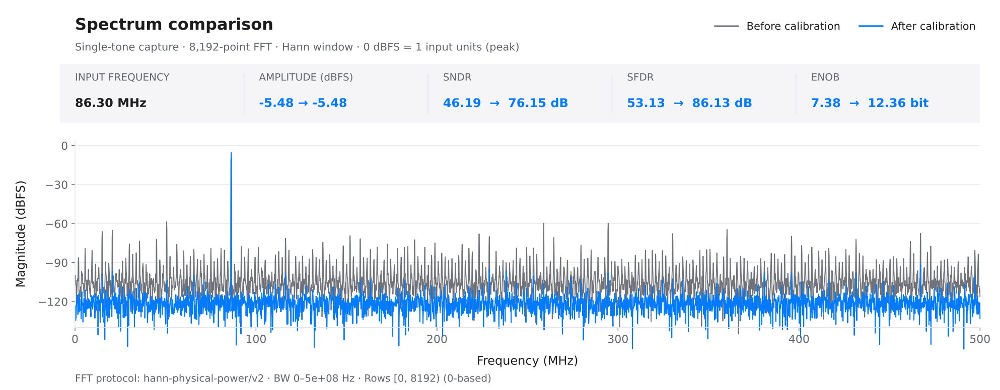

# 快速上手：用 demo 完成 ADC 校准

[安装说明](installation.zh-CN.md) · [完整教程](user-guide.zh-CN.md) · [配置参考](reference.zh-CN.md) · [English](quick-start.md)

本教程使用提供的 20 份 ADC 仿真采集，完成 **预处理 → 小模型训练 → 独立测试 → 频谱解读**。完成后应得到 16 组训练数据、4 组留出数据、一个 **6→2→1** 的 KAN 模型，以及全部留出组的校准报告。界面截图来自实际软件操作，项目路径随本机位置变化。

## 1. 准备软件并认识数据

按[安装说明](installation.zh-CN.md)完整解压软件，运行 `KAN Workbench.exe`；训练使用兼容的 NVIDIA GPU。进入 **设置** 确认 CUDA 可用，异常时先按 [GPU 排错](troubleshooting.zh-CN.md#gpu)处理。

在本仓库首页选择 **Code → Download ZIP**，解压后找到 `examples/tutorial/raw/`。本教程与这 20 份数据配套；安装包附带的旧资料可能使用另一套样例。可将 `raw` 文件夹复制到可长期保留的位置，例如 `C:\ADC-Tutorial-v350\raw`。

| 数据内容 | 含义与操作要求 |
| --- | --- |
| 20 个 `capture_*.csv` | 每个文件是一组完整采集；全部放在同一目录，由软件自动分集 |
| 每文件 8192 行、6 列 | 每行对应同一时刻的六个 ADC 级码字；没有表头、时间列或序号列 |
| 第 1–5 列 | 五个 2.5-bit 级的有符号码字，合法范围为 -4 至 4 |
| 第 6 列 | 4-bit 后端码字，合法范围为 -8 至 7 |
| 单通道、单音、1 GS/s | 采样率为 1 GHz；各文件输入频率和相位不同，模拟输入峰值均为 -3 dBFS |

`capture_001.csv` 的前三行如下。逗号只分隔 ADC 级，不分隔训练集和测试集；2.5 bit 是级结构描述，CSV 中保存整数码字。

```text
2,0,2,-1,1,-4
0,-2,1,1,-1,1
-1,-2,1,1,-1,2
```

该 demo 模拟同一个 ADC 的固定增益误差、DAC 电平偏差、比较器偏移和小幅非线性，并叠加输入随机噪声。没有记忆效应、抖动或温漂。输入噪声 RMS 为 0.25 LSB，LSB 按 14 bit、±1 V 满量程定义。完整条件见[样例说明](../examples/README.md)与[数据清单](../examples/tutorial/manifest.json)。

### 本次流程的目的

| 阶段 | 输入 | 产出与目的 |
| --- | --- | --- |
| 预处理 | 原始六列码字 | 建立训练输入、补偿基准和正弦参考，同时留出独立测试采集 |
| 训练 | `train_16` | 学习由级码字到补偿量的映射，得到模型检查点 |
| 测试 | 模型＋`raw_test` | 将固定模型应用到未参加本次训练的四组采集，检查实际改善 |

训练目标是 `reference - baseline`，校准输出为 `baseline + 模型预测补偿量`。`reference` 由预处理的单音拟合产生；CSV 不含理想输出标签，模型也不读取仿真器的真实误差参数。

## 2. 新建项目并设置预处理

在左侧项目区选择 **新建**。软件自动创建按时间命名的项目，可点 **编辑** 重命名；选择 **目录** 可定位项目文件夹。以下结果均保存在这个项目内，无需手动创建输出子目录。

进入 **数据** 页，在 **原始数据目录** 中选择刚才的 `raw` 文件夹。

### 数据位置与编码

| 界面字段 | 本例设置 | 原因 |
| --- | --- | --- |
| 输出格式 | `CSV` | 便于查看生成的数值文件 |
| 测试集比例 | **20%** | 按完整文件留出 4/20 组，避免同一采集同时参与训练与最终测试 |
| 输入编码 | `有符号十进制` | 原始值包含负整数，不能按无符号或二进制解释 |
| 通道数／输入信号 | `1`／`单音` | 与单通道正弦采集一致 |
| 原始数据来源／模型输入模式 | `各级码字`／`各级码字` | 保留六个级的观测信息 |
| 补偿基准来源 | **初始参数合成** | 以名义参数重建的未补偿输出作为统一比较起点 |



### ADC 结构与校准策略

| 界面字段 | 本例设置 | 原因 |
| --- | --- | --- |
| ADC 级数 | `6` | 与六列数据一一对应 |
| 第 1–5 级位宽 | 各 `2.5` bit | 对应五个冗余流水线级 |
| 第 6 级位宽 | `4` bit | 后端量化器与前五级不同，须单独核对 |
| 第 1–5 级“到下一级增益” | **全部为 4** | 与本例名义结构一致；第 5 级也填 4 |
| 码字合成 | `按级间增益自动计算` | 由名义增益生成合成权重 |
| 抽样比例／校准质量 | `100%`／`快速` | 数据量小，保留全部采样点完成准备 |
| 全部 IGE／全部 DAC | **均关闭** | 本轮先观察 KAN 补偿本身的效果，不叠加粗校准优化 |

可将 **统一级间增益** 填为 `4`，再点 **应用全部**，随后逐行核对。检查五个 IGE 和五个 DAC 开关均为灰色关闭状态。不要只填写顶部统一值而忽略下方逐级表格。



## 3. 执行检查和预处理

1. 选择底部 **1. 检查数据**。确认识别到 **20 个文件、每个 6 列**，没有编码或格式错误。
2. 选择 **2. 开始预处理**，等待状态变为 **预处理完成**。
3. 在检查结果中确认 **训练集 16 组、测试集 4 组**。选择 **打开目录** 查看生成结果。

需要修改已检查的设置时，先点 **重新开始**，再检查和执行。重新检查可能重新随机划分文件；本次划分的具体编号以生成结果为准，训练随机种子不能固定预处理分集。

```text
项目目录/outputs/preprocessing/v001/
├─ train_16/
│  ├─ inputs/       六列归一化模型输入
│  ├─ baseline/     名义参数合成的单列补偿基准
│  └─ reference/    单音拟合生成的单列目标参考
├─ test_4/          留出组对应的预处理数据
└─ raw_test/        留出原始采集的测试入口
```

**完成检查：**三类文件合计各 20 个，其中 16 组在训练目录、4 组在测试目录。`raw_test` 中可能只有 `raw_sources.json`，它记录原始文件引用，不要求出现四个 CSV；保留原始 `raw` 目录。目录已有任务时，版本号可能为 `v002` 等，应使用本次生成的目录。

此时“粗校准前后 ENOB”不变是本配置的预期结果，因为 IGE/DAC 优化已关闭。预处理的目标是准备数据与分集，KAN 校准改善应在训练后的独立测试中查看。

## 4. 配置小网络

进入 **配置**，选择 **浮点模型 → 模型训练**。顶部 **训练数据** 通常已自动关联到本次 `train_16`；核对目录末尾，不要选择原始 `raw`、`test_4` 或 `raw_test`。将 **每组读取行数** 设为 `8192`，读取每个训练文件的全部点。

在 **数据读取** 页签设置 **输入模式：各级码字；采样频率：1 GHz；输入信号：单音**。采样率用于正确标注测试频率，1 GHz 等于 1000 MHz。



在 **网络设置** 页签填写下表。隐藏层字段只填一个数字 `2`，表示一个含 2 个节点的隐藏层。

| 界面字段 | 本例设置 | 原因 |
| --- | --- | --- |
| 窗口数量 | **1** | demo 没有记忆效应，每次使用当前采样点的六个级码字 |
| 隐藏层（逗号分隔） | **2** | 保持网络小；本轮训练侧验证选定的结构 |
| 网格数 grid／样条阶数 k | `1`／`2` | 为静态误差提供有限的非线性表达能力 |
| 基础函数 | `identity` | 保留线性分支 |
| 多通道输出使用独立 KAN | 关闭 | 本例只有一个输出通道 |



**完成检查：**网络预览应为 **6→2→1**，软件记录本配置共 **214 个参数**。输入节点数 6 来自“六列 × 一个采样点”，输出节点表示一个补偿量。若预览为 30 个输入，说明窗口仍是 5，应改为 1；若预览仍显示待检测的输入维数，重新选择本次训练目录。

## 5. 训练并确认模型保存

进入 **训练设置**，填写基本参数，再展开 **训练策略** 和 **运行设置**。

| 位置／字段 | 本例设置 | 作用 |
| --- | --- | --- |
| 训练轮数／批大小 | `120`／`256` | 固定训练预算，分批更新参数 |
| 学习率 | `0.001` | 控制每次参数更新幅度 |
| 标准化补偿目标 | **开启** | 将幅度较小的补偿量缩放到适合优化的尺度 |
| 训练策略：优化器／损失函数 | `adamw`／`mse` | 拟合预测补偿量与目标补偿量的均方误差 |
| 调度器／余弦周期／最低学习率 | `cosine`／`120`／`0.000001` | 训练后段逐步减小更新步长 |
| 权重衰减 | `0.0001` | 使用轻度参数约束 |
| 动量系数 β1／β2、数值稳定项 ε | `0.9`／`0.999`、`0.00000001` | 与验证配置一致 |
| AMSGrad／启用早停 | 均关闭 | 完成固定的 120 轮，避免不同运行提前结束 |



**运行设置**使用 **计算设备 `cuda`、数值精度 `float64`、随机种子 `1`**。在 **评估记录** 页签关闭“训练后评估当前数据”，并将逐轮频谱输入留空。本教程在训练完成后使用独立留出采集做最终测试。



选择右下角 **开始训练**。软件切换到 **训练** 页后，确认设备显示 **CUDA · FP64**，轮次持续增加，损失为有限数值。损失总体应下降，但不要求每一轮严格下降。

**完成检查：**状态显示 **训练完成**、进度 **120/120**。使用 **打开目录** 可找到本任务的 `checkpoints/best.pt` 和 `checkpoints/last.pt`。`best.pt` 是按训练损失保存的检查点，不代表已经通过独立测试；低训练损失本身不能证明没有过拟合。

## 6. 对四组留出数据进行测试

在已完成的 **训练** 页选择底部 **模型测试**，软件会带入本次 `best.pt` 和预处理的 `raw_test`。也可以从左侧 **测试** 进入并手动选择。

1. 核对 **测试模型** 指向刚完成任务的 `checkpoints/best.pt`。
2. 核对 **原始采集数据目录** 指向本次预处理的 **`raw_test`**。`test_4` 是预处理产物目录，此入口需要原始采集或其引用；不要选择包含全部 20 组的原始目录。
3. 设置 **输入信号：单音；每组读取行数：8192**。采样率和预处理参数随模型读取，本例为 1 GHz。
4. 选择 **开始测试**。完成状态应为 **4 组数据**。

在 **单组 FFT** 页签选择采集编号，同时开启 **校准前** 和 **校准后**；使用前后箭头逐组查看。在 **全部数据组指标** 页签查看全部组，不能只用改善最大的一组代表本次实验。



## 7. 理解频谱、噪底与校准效果

下图是本次实际测试中的一组仿真采集，图中的校准输出来自软件模型。校准前后使用同一采集、8192 点周期 Hann 窗与 0–500 MHz 频带。



先看基波的位置和幅度是否保持，再看谐波与杂散是否减小。**SNDR** 综合计入噪声和失真，**SFDR** 关注最大杂散；两者均须在相同计算条件下比较。ENOB 由 SNDR 换算，不能将其理解为 ADC 的物理位数增加。

### 随机噪声不会因静态校准而消失

频谱中看似连续的“底部”可能同时包含输入随机噪声、量化误差和码字重建误差。校准后底部变低，不能直接解释为模型消除了真实输入噪声。

为核查这一点，使用已公开的仿真器参数建立额外对照：从相同 ADC 码字按已知增益、DAC 偏差和非线性反演，并保留输入噪声与后端量化误差。这个参照仅用于验证和作图，训练模型没有读取这些真实参数。


在 262,144 对独立噪声输入的对照中，本模型的随机输入噪声传递系数为 **1.0009**，约为 1；保留下来的随机输出 RMS 为输入噪声 RMS 的 **1.526 倍**，其中还含量化及剩余转换误差。同一固定模型在训练组和最终测试组上的平均 SNDR 分别为 **76.04 dB 和 76.11 dB**，未出现明显训练优势。完整计算条件与结果见[小模型验证与噪声核查](../examples/tutorial/model-validation.md)。这是本仿真条件下的核查结果，不是任意模型不会过拟合的保证。

### 全部留出组的结果

| 采集 | SNDR 前 | SNDR 后 | 提升 | SFDR 前 | SFDR 后 | 提升 |
| --- | ---: | ---: | ---: | ---: | ---: | ---: |
| 006 | 46.19 | 76.15 | +29.97 | 53.13 | 86.13 | +33.00 |
| 012 | 46.19 | 76.13 | +29.94 | 53.08 | 86.51 | +33.43 |
| 013 | 46.18 | 76.05 | +29.86 | 53.09 | 86.39 | +33.29 |
| 009 | 46.18 | 76.10 | +29.92 | 53.03 | 86.16 | +33.13 |

单位：dB。以上包含本次留出的全部四组。软件按文件随机分集，其他运行的采集编号、训练损失和指标可能略有差异。

本教程参数先在训练侧的独立验证组中确定，再固定结构与训练预算，最终测试组不用于选结构、选轮次或选检查点。读者按固定配置完成流程即可；自行调参时应另留验证数据，最终测试数据继续保持独立。当前 demo 只验证固定器件、固定幅度下的新采集，不代表跨幅度、跨温度或跨器件的泛化性能。

## 8. 保存实验并复查完成情况

使用各页的 **打开目录**，保存完整项目及原始 `raw` 数据。模型测试目录中的 `test_summary.json` 和 `fft_summary.csv` 汇总所有采集；`groups/` 保存逐组预测、指标和 SVG 频谱。

确认预处理得到 16/4 分集、训练完成、测试报告含 4 组，并能打开模型与频谱。不要只复制 `best.pt`：后续测试和迁移还需要配套配置、预处理参数及数据引用。备份方法见[保存、继续与迁移](user-guide.zh-CN.md#backup)；使用实测采集时按[完整教程](user-guide.zh-CN.md)重新核对 ADC 结构与采集条件。
