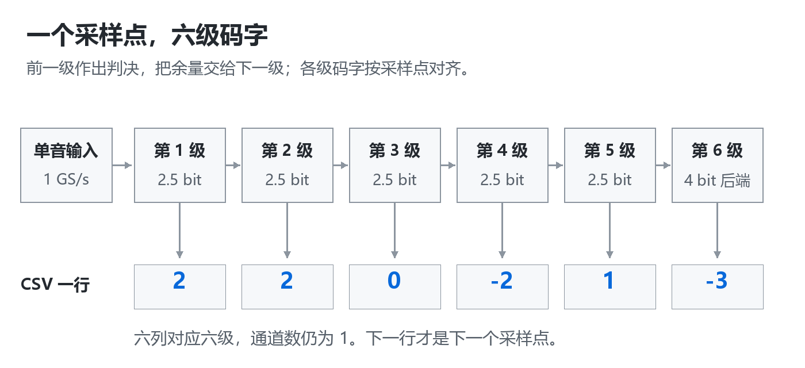
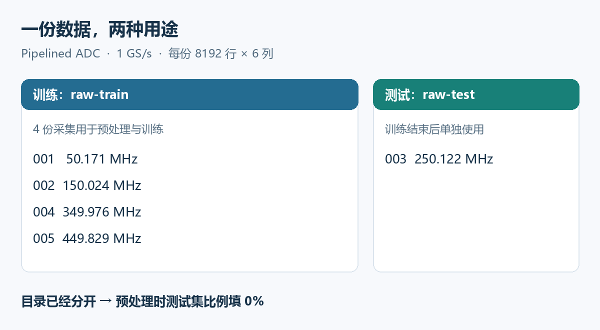
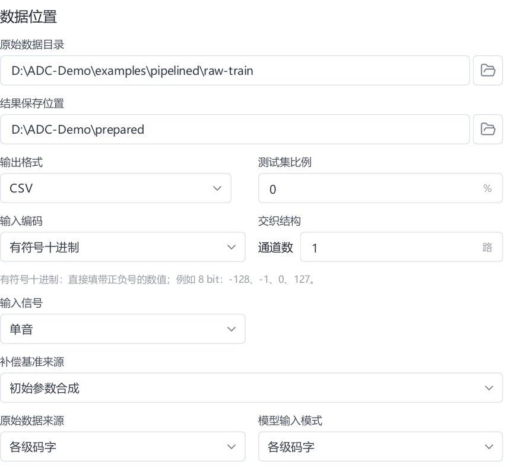
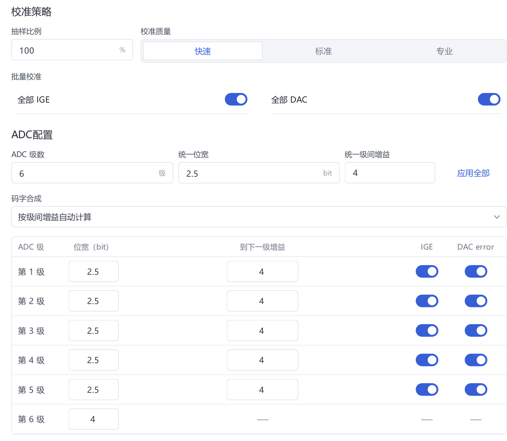
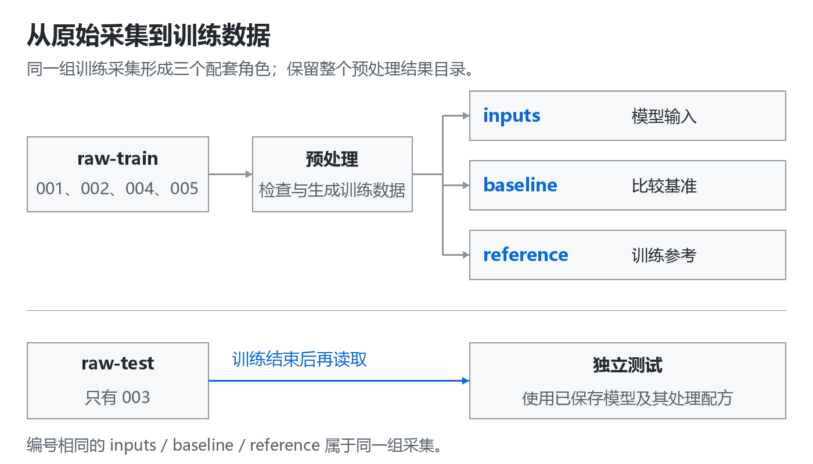
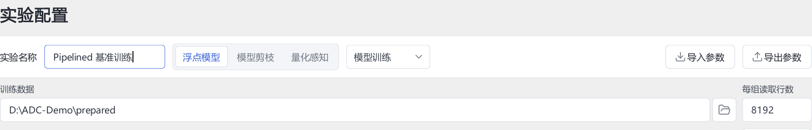
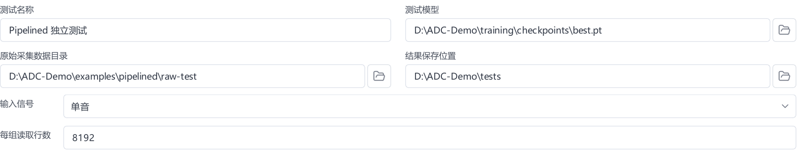
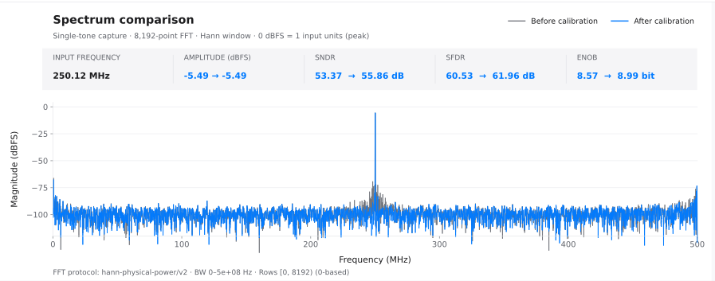

# Pipelined ADC 图解教程

Auto ADC Calibration · 从仿真码字到独立测试 · 文档 v3.5.0

用一套六级流水线（pipelined）ADC 仿真数据，完成 **认识数据 → 预处理 → 训练 → 独立测试 → 保存实验**。第 1～8 节是一条连续练习，第 9 节说明如何换成自己的采集。

准备好已启动的软件和[配套文档包](https://github.com/UESTC-MSDC/auto-adc-calibration/releases/tag/v3.5.0)中的 `examples/pipelined/`。本例使用 CPU，不需要 Python 或 MATLAB；下载方法见[安装说明](installation.zh-CN.md)。

完成后，你会得到一个训练模型、003 组的校准前后频谱，以及可以重新打开的实验记录。每一步先操作，再按“完成检查”确认；遇到问题可查[故障排查](troubleshooting.zh-CN.md)。

## 1. 先看懂这颗 ADC 和一行数据

### 从模拟输入到六列码字

流水线 ADC 分级处理输入。一级先给出一个粗略判决，再把尚未分辨的部分，也就是“余量”，交给下一级。后面的级继续细分，最后把各级码字按对应关系合成。

本例有 **5 个 2.5-bit 级和 1 个 4-bit 后端**。每个采样点留下六个整数，所以 CSV 有六列。六级属于同一个 ADC 通道，界面中应填写“6 级、1 通道”。

打开 `raw-test/capture_003.csv`，第一行应是 `2,2,0,-2,1,-3`，与图中六个码字一一对应。

这里的数字是各级判决码，不是电压，也不是六个连续时刻。往下换一行，才是下一个采样点。本例的阶段数据已按同一输入采样对齐；换成硬件导出的数据时，也需要先确认各级延时对齐。

“2.5 bit”是本例级结构的规格标签，CSV 中仍是整数：前五列为 -4～4，末列为 -8～7。不要把 2.5 理解为小数码字，也不要把六个位宽直接相加作为最终有效精度。

### 为什么需要校准

这个仿真模型加入了固定的级间增益偏差、比较器与 DAC 误差、非线性及记忆项，并在输入端加入噪声。五份文件使用同一组器件误差，但输入频率不同，可以理解为用不同单音测试同一颗模拟 ADC。

本次练习要回答的是：**用四个频率的采集训练后，对没参加训练的第五个频率，校准后的噪声与失真是否减少？** 先掌握这条实验思路，再看操作。

> **完成检查**　能解释“一份 CSV 是一组采集、一行是一个采样点、一列是一级码字”；知道这套数据来自仿真。以下配置仅适用于这个例子。

## 2. 准备四组训练和一组测试

### 找到配套样例

在 v3.5.0 软件的 `Documentation/examples/pipelined/`，或独立文档包的 `examples/pipelined/` 下找到两个文件夹。旧版两列样例不是本教程的六级数据。

| 目录与文件 | 单音频率约值 | 用途 |
| --- | ---: | --- |
| `raw-train/capture_001.csv` | 50.171 MHz | 训练 |
| `raw-train/capture_002.csv` | 150.024 MHz | 训练 |
| `raw-test/capture_003.csv` | 250.122 MHz | 独立测试 |
| `raw-train/capture_004.csv` | 349.976 MHz | 训练 |
| `raw-train/capture_005.csv` | 449.829 MHz | 训练 |

每份文件都是 **8192 行、6 列、无表头的有符号十进制整数**。总采样率为 1 GS/s，界面以频率单位显示时填 **1 GHz**；这不是输入单音的频率。输入峰值设为相对仿真参考电压的 -3 dBFS。精确频率、文件散列和噪声条件见[样例清单](../examples/pipelined/manifest.json)。

### 为什么现在就分开

如果同一份数据既训练又测试，就难以判断模型是否适用于新的采集。这里按完整文件留出 003，训练时不能选择它。后面预处理的“测试集比例”填 **0%**，意思是“不再从四份训练文件中另分一份”，并不是取消测试。

先保留原始 CSV，不用表格软件重新保存，也不添加列名、时间戳或序号。预处理会另外生成训练数据。

> **完成检查**　`raw-train` 只有 001、002、004、005；`raw-test` 只有 003。可以只读打开 003 看格式，但不将它放入预处理或训练目录。

## 3. 新建项目并选择训练输入

项目用于集中保存本次练习的配置和结果。软件目录、项目目录、原始采集目录可以位于不同位置；请分别记清楚。

### 操作

1. 在左侧选择 **新建**，项目命名为“Pipelined 入门”，选一个可写目录，例如 `D:\ADC-Projects\Pipelined-Demo`。
2. 进入 **数据**，原始数据目录选择 `examples/pipelined/raw-train`。不要选择其上层 `pipelined`，也不要选 `raw-test`。
3. 按下表填写。此时只设置数据怎样读取，下一节再填写 ADC 的级结构。

| 界面设置 | 本例填写 | 为什么这样填 |
| --- | --- | --- |
| 原始数据来源 | 各级码字 | 每个采样点有六级判决 |
| 模型输入模式 | 各级码字 | 保留各级信息用于训练 |
| 输入编码 | 有符号十进制 | 文件含正数、零和负数 |
| 输出格式 | CSV | 保存这次的预处理结果 |
| 通道数 | 1 | 六列是六级，不是六路交织 |
| 输入信号 | 单音 | 每份采集只有一个输入正弦 |
| 测试集比例 | 0% | 003 已在另一个目录中保留 |

截图取自本地 v3.4.0 界面，流程另已用公开 v3.3.1 Worker 验证。不同版本的布局或图表标注可能略有差异；以本节字段名称和填写值为准。截图中的路径不需要照抄。

> **完成检查**　当前原始目录中只有四份训练 CSV，输入方式为单通道各级码字。若读取数量不对，先修正目录，再继续。

## 4. 填写 ADC 参数并完成预处理

### 告诉软件每列代表什么

| 界面设置 | 本例填写 | 含义 |
| --- | --- | --- |
| ADC 级数 | 6 | 与 CSV 的六列对应 |
| 第 1～5 级位宽 | 各填 2.5 bit | 前五个流水线级 |
| 第 6 级位宽 | 4 bit | 最终后端量化级 |
| 到下一级增益 | 前五级各填 4 | 名义级间增益；末级无下一段 |
| 码字合成 | 按级间增益自动计算 | 使用这套 ADC 的名义关系 |
| 补偿基准来源 | 初始参数合成 | 固定本次比较的起点 |
| 抽样比例 | 100% | 这套小样例使用全部采集 |
| 校准质量 | 快速 | 先完成入门流程 |

这里填的是设计上的**名义增益 4**，不是仿真里加入误差后的实际增益。我们正是要观察存在这些误差时的校准效果。第六级之后没有其他级，因此只填五个级间增益。

### 检查，再开始

1. 选择 **检查数据**，确认文件数、列数、编码与范围通过检查。
2. 选择 **开始预处理**，等待任务完成。需要改设置时，先按界面提示重新开始检查。
3. 找到预处理结果根目录。下一步选择的是这个整体目录，而不是其中一个子目录。

### 预处理究竟产生了什么

原始 CSV 只有 ADC 码字，不能直接等同于训练所需的完整数据。软件整理模型输入、构成补偿基准，并根据所选信号类型生成训练参考。本例参考来自采集的单音拟合，不是另外提供的理想仿真电压文件。

图中的三个角色各有用途：`inputs` 是模型输入，`baseline` 是比较基准，`reference` 是训练参考。末尾编号相同的文件属于同一组采集，不要用测试数据替换训练参考。

软件还保存 ADC 配置和预处理配方，之后测试会用到。请保留整个结果目录，不混合不同预处理任务的文件。

> **完成检查**　四组训练采集处理完成；根目录有 `inputs`、`baseline`、`reference`。本例 0% 划分不会自动生成 `raw_test`，后续使用原样例中的 `raw-test`。

## 5. 训练第一个校准模型

这一轮先用 20 轮训练建立基准实验，搜索、剪枝和量化留到后面。

### 操作

1. 进入 **配置 → 浮点模型 → 模型训练**。新项目使用默认模型设置，不加载其他实验的配置。
2. 确认自动关联的数据集；如果手动选择，选第 4 节得到的预处理根目录。实验名填写“Pipelined 基准训练”。
3. 按下表设置，选择 **开始训练**，再到 **训练** 页查看进度。

| 设置 | 本例填写 |
| --- | --- |
| 输入信号 | 单音 |
| 总采样率 | 1 GHz，即 1,000,000,000 次采样/秒 |
| 每组读取行数 | 8192；这是每份 CSV 的上限 |
| 训练轮数 | 20 |
| 批大小 | 256，即每次参数更新使用的样本量 |
| 学习率 | 0.001，控制参数更新步长 |
| 目标归一化 | 开启 |
| 运行设备 | cpu |
| 数值精度 | float64 |

### 怎样看训练进度

确认任务运行在 CPU 且轮数在推进。损失（loss）反映训练误差，不必每轮都下降；是否改善频谱，要在下一节独立测试。

> **完成检查**　任务完成且能选择“Pipelined 基准训练”的模型。保留整个训练任务及其中的 `checkpoints/best.pt`；失败或取消时先查错误，不能仅凭模型文件判断完成。

## 6. 只用 003 组做独立测试

训练结束后才读取预留的 003。测试会使用模型保存的 ADC 设置与预处理配方处理原始码字，因此无需把 003 加入训练数据，也不用重新预处理整个训练集。

### 操作

1. 打开 **测试**，选择第 5 节训练任务生成的模型。
2. 原始采集目录选择 `examples/pipelined/raw-test`。
3. 信号模式选择 **单音**，每组读取行数填 **8192**。核对模型记录的总采样率为 **1 GHz**，然后 **开始测试**。

采样率随模型读取。如果显示不是 1 GHz，先核对模型是否选错、训练时是否填错。不要为了对齐图上的频率临时换算或修改 CSV。

| 看到的现象 | 应当怎样处理 |
| --- | --- |
| 测试列表出现 001、002、004、005 | 选到了训练目录，改为 `raw-test` |
| 提示输入格式或列数不符 | 确认选择原始 CSV，未选到 `inputs` 或预处理根目录 |
| 提示缺少配方或配套文件 | 恢复完整训练任务，再选择其中的模型 |
| 任务已完成但没有 003 结果 | 核对输入目录、读取范围和任务错误记录 |

> **完成检查**　本次测试只出现采集 **003**，可以查看它的校准前后频谱和指标。保存这一轮结果，再去读图。

## 7. 从频谱读出校准效果

### 按这个顺序看图

1. **先看对象与条件。** 当前采集应为 003，读取 8192 行，总采样率 1 GHz。确认校准前后属于同一份采集。
2. **找到输入单音。** 主峰应在约 **250.12 MHz**。横轴是频率；本例单边频谱显示到约 500 MHz，也就是采样率的一半。
3. **观察主峰以外。** 零散突起可能是杂散，连续的低幅度背景构成噪声底。先用图定位变化，再看数值判断整体改善。
4. **比较 SNDR 和 SFDR。** SNDR 汇总噪声与失真的影响；SFDR 关注最大杂散。两项描述不同现象，改善量不必一样。

此图裁去界面空白，保留原始频谱与标注，可对照[完整结果界面](../assets/pipelined/06-test-result.png)。

### 对照一次已验证的运行

| 指标 | 校准前 | 校准后 | 改善 |
| --- | ---: | ---: | ---: |
| SNDR | 53.37 dB | 55.86 dB | +2.50 dB |
| SFDR | 60.53 dB | 61.96 dB | +1.43 dB |

这组记录来自 **v3.3.1 Worker、CPU、20 轮、采集 003、8192 行**，验证日期为 2026-10-17。改善按未舍入的数值相减，再保留两位小数；因此不必等于表格中两个已舍入数的差。完整精度记录见[样例清单](../examples/pipelined/manifest.json)。

在相同测试条件下，SNDR 和 SFDR 越高越好。本次两项都提高，说明这一轮模型对预留采集有所改善。它只支持这套仿真条件下的结论，不能据此推断所有频率、幅度、器件或实测 ADC 都会得到相同改善。

### 三个容易误读的地方

**训练损失下降，不保证频谱指标提高。** 如果自己的 SNDR 没有改善，先检查是否用同一测试采集、相同读取范围及正确模型，再讨论参数调整。

**噪声底不是 SNDR。** 频谱每个频点的高度与 FFT 长度和分析方式有关，不能把图上约 -100 dB 的背景直接当作 100 dB 的 SNDR。比较时保持采样率、读取行数和分析条件一致。

**生成器与图表的幅度参照需要分清。** 数据生成时的 -3 dBFS 相对于仿真参考电压；截图说明中的 0 dBFS 定义为软件输入单位的峰值 1。不要用这两个不同参照下的幅度数字是否相等判断校准成败。

> **完成检查**　能找到主峰、读出两项指标，并说清楚这次测试的采集与条件。数值与示例略有差异时，以自己的完整报告为准，不把上表作为必须达到的门槛。

## 8. 保存一份可以重新打开的实验

选择任务的 **打开目录** 可以找到结果，但这一步只负责定位文件，还没有完成备份。请在任务完成或正常停止后，复制完整项目及其引用的外部原始数据。

| 保存对象 | 本例应保留什么 | 为什么需要 |
| --- | --- | --- |
| 原始采集 | `raw-train` 与 `raw-test` 中全部五份 CSV | 重跑实验、核对训练与测试划分 |
| 预处理结果 | 完整根目录及配套配置 | 恢复输入、参考和处理配方 |
| 训练任务 | 模型、训练设置与训练记录 | 继续训练或重做测试 |
| 测试任务 | 003 的报告、指标与频谱 | 复查本次校准效果 |

在实验备注中记录：实际软件版本、样例版本、训练文件编号、测试编号 003、CPU、20 轮、1 GHz、8192 行，以及所选模型。可以保存截图用于展示，但截图不能代替完整任务文件。

项目可能只引用外部数据，移动项目不会自动移动所有原始采集。完成备份后，从副本打开项目，确认能找到模型与测试报告；原始数据位置发生变化时，通过软件正常入口重新关联。更多操作见[升级与备份](upgrade.zh-CN.md)。

> **完成检查**　能从记录找到“哪份数据、哪个模型、哪次测试”，并打开对应结果。做到这里，首次校准流程已经完成。

## 9. 换成自己的数据，再选下一步

### 先做一个小实验

为真实采集另建项目，先留出最终测试文件。对照[数据格式](data-format.zh-CN.md)确认列数、编码、级间对齐、信号类型和采样率，再用少量训练文件重复第 3～8 节。

| 数据有什么变化 | 需要重新核对 |
| --- | --- |
| 换了 ADC 级结构 | 级数、位宽、名义级间增益及各级延时对齐 |
| 只有一列最终输出码字 | 选择最终输出码字，填写输出位宽与编码 |
| 单音变为双音 | 信号模式和所需频率提示 |
| 使用交织采集 | 通道数、逐行通道顺序、合并输出总采样率 |
| 改变采集长度或输入频率 | 读取范围、频谱主峰与测试条件 |

本例的 1 GHz、六级和增益 4 不是所有 ADC 的默认值。先让数据检查和独立测试都能完成，再增加数据量。

### 只选择一个下一步目标

| 目标 | 操作入口 | 完成后看什么 |
| --- | --- | --- |
| 找到合适的模型配置 | 配置 → 浮点模型 → 模型搜索 | 方案满足条件后，用保留数据复测 |
| 减小模型 | 配置 → 模型剪枝 | 验收状态及精度变化 |
| 准备量化模型 | 位宽扫描 → 应用方案 → 量化训练 | 量化训练与最终验收 |
| 评估硬件 | 硬件 → 对应 RTL / ASIC 流程 | 实际运行阶段的报告 |

保留本次基准实验，为新设置建立独立任务。如果反复查看 003 的结果来挑参数，它就变成了方案选择数据；需要另外留出最终测试采集。模型搜索、剪枝验收和位宽选择也遵循同样的原则。

> **完成检查**　明确下一轮只改变什么、用哪些数据选方案、用哪些数据最终测试。导出 RTL、通过仿真、完成综合和实物验证是不同阶段，详见[硬件说明](hardware.zh-CN.md)。

需要查设置时使用[手册](user-guide.zh-CN.md)，遇到异常先查[故障排查](troubleshooting.zh-CN.md)，仍有问题可按[反馈说明](../SUPPORT.md)提交复现信息。
