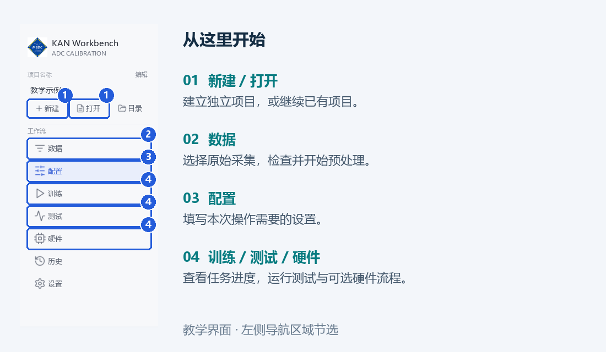
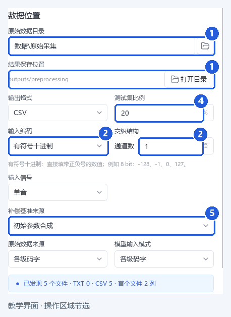
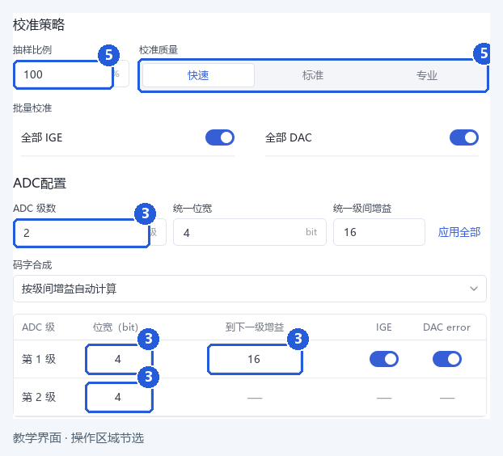
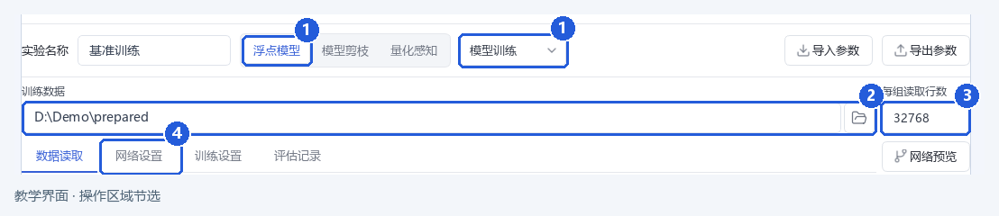
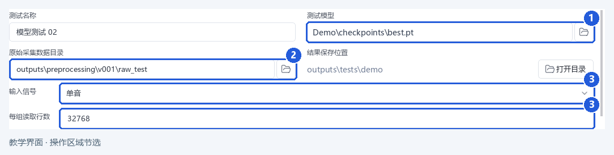
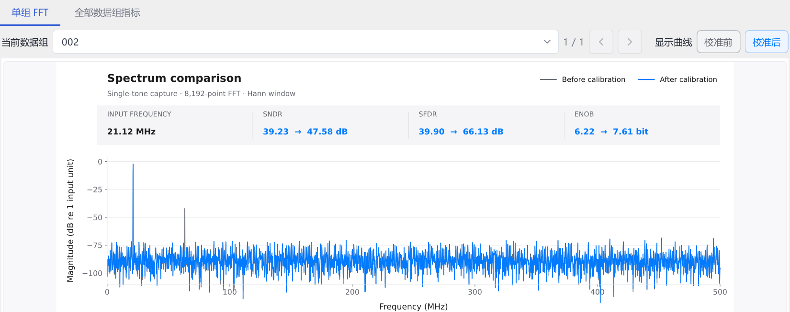
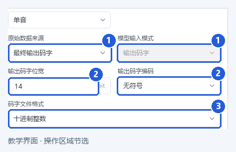

# 图解教程

Auto ADC Calibration · 首次使用 · 2026 年 10 月

通过一个单音演示项目，学习数据准备、模型训练、独立测试和结果保存。按第 1～6 节依次操作即可完成基础流程；第 7～8 节供按需查阅。

**完成目标：建立项目 → 准备数据 → 训练模型 → 测试并保存。** 安装及启动步骤见[安装说明](installation.zh-CN.md)。

> **样例与配图**　样例由脚本合成，包含正弦信号、少量谐波与噪声，未使用真实 ADC 采集。图 6 来自随附样例的实际 CPU 训练与独立测试；其余配图为操作区域示意，路径已作示例化处理。操作时以本教程设置表为准，示例结果不代表真实 ADC 性能。

## 1. 创建演示项目

**目标：** 建立独立工作空间，并准备本教程使用的样例。

### 操作步骤

1. 启动 `KAN Workbench.exe`，在左侧选择 **新建**。
2. 选择独立、可写的项目目录。建议将演示项目命名为“单音校准演示”。
3. 找到随附的各级码字样例，将 `examples/stage-codes/raw` 作为原始采集目录。

### 样例信息

| 项目 | 本例内容 |
| --- | --- |
| 数据规模 | 5 组，每组 8192 个采样点 |
| 文件格式 | CSV；2 列整数；无表头 |
| 使用目的 | 学习操作及检查输入格式 |

> **完成检查**　项目已打开，样例目录可访问。保留原始文件，后续测试仍需读取原始采集。

## 2. 选择数据与文件格式

**目标：** 让软件正确识别演示文件。

### 操作步骤

1. 进入 **数据**，选择各级码字样例目录。
2. 按下表设置数据来源、编码和信号类型。
3. 将测试集比例设为 **20%**，为后续测试预留一组采集。

### 本例设置

| 设置 | 填写值 |
| --- | --- |
| 原始数据来源／模型输入模式 | 各级码字／各级码字 |
| 输入编码／文件类型 | 有符号十进制／CSV |
| 通道数／输入信号 | 1／单音 |
| 测试集比例 | 20% |

> **完成检查**　所选目录包含 5 个样例文件，文件类型和列数与本例一致。具体编码约定见[数据格式](data-format.zh-CN.md)。

## 3. 配置 ADC 并预处理

**目标：** 生成训练数据集，并保留独立测试数据。

### 操作步骤

1. 按下表填写 ADC 与预处理设置，其余首次保留默认。
2. 选择 **检查数据**，按提示处理发现的问题。
3. 检查通过后，选择 **开始预处理**，等待任务结束。

### 本例设置

| 设置 | 填写值 |
| --- | --- |
| ADC 级数／每级位宽 | 2／两级均为 4 bit |
| 到下一级增益 | 第 1 级填 16；最后一级不填 |
| 总采样率 | 1 GHz（演示设置） |
| 抽样比例／校准质量 | 100%／快速 |

> **完成检查**　本例得到 **4 组训练数据、1 组测试数据**。后续训练优先使用软件自动关联的目录，无需手动修改文件夹编号。

## 4. 训练模型

**目标：** 完成一次短训练，获得可供测试的模型。

### 操作步骤

1. 进入 **配置 → 浮点模型 → 模型训练**。
2. 确认自动关联的训练数据集；手动选择时，选择预处理结果根目录。建议将实验命名为“基准训练”，并核对 **单音 / 1 GHz**。
3. 按设置表配置，选择 **开始训练**。在 **训练** 页查看实际设备、进度和损失曲线。

### 本例设置

| 设置 | 填写值 |
| --- | --- |
| 每组读取行数 | 32768；短文件读取可用行 |
| 训练轮数／批大小 | 20／256 |
| 学习率／目标归一化 | 0.001／开启 |
| 运行设备／其他设置 | cpu（本次配图）／保留默认 |

> **完成检查**　任务已结束，并生成可选择的模型。20 轮用于熟悉操作；校准效果由下一步独立测试确认。使用 GPU 时可选择 auto，确认实际设备；显存不足时可降低批大小。

## 5. 测试模型

**目标：** 使用预留的原始采集，评估训练后的模型。

### 操作步骤

1. 打开 **测试**，选择上一阶段生成的模型。
2. 选择预处理结果中的原始测试入口，或另外保留的原始采集目录。
3. 核对 **单音** 和每组读取行数，选择 **开始测试**。

### 数据选择

| 数据 | 是否用于本步骤 |
| --- | --- |
| 预留的原始采集 | 是；本例使用预留的 1 组 |
| 训练数据集的内部子目录 | 否；不能替代原始测试输入 |

> **完成检查**　测试正常结束，结果页可以选择本次采集并查看校准前后指标。缺少配套文件时，回到对应项目找回完整任务结果。

## 6. 查看并保存结果

**目标：** 理解本次测试的覆盖范围，并保存可复查的结果。

### 操作步骤

**选择采集 → 比较频谱及 SNDR / SFDR → 打开目录保存**。多组测试须逐组查看，记录改善与异常。

### 保存记录

记录采集来源、采样率和读取范围；注明项目、实验、模型及软件版本，并保留图表、报告和任务状态。

> **完成检查**　本次预留采集 002 的 SNDR 为 **39.23 → 47.58 dB**，SFDR 为 **39.90 → 66.13 dB**。这是合成样例的一次运行记录；设备和运行条件变化时不要求数值完全相同。保存时让模型、测试结果与原始数据对应。

## 7. 选择后续工作流程

**目标：** 在完成基础流程后，按实际任务继续使用相关功能。

### 功能选择

| 需要完成的任务 | 操作入口与顺序 | 完成后 |
| --- | --- | --- |
| 尝试其他模型 | 配置 → 浮点模型 → 模型搜索 | 选择结果，以独立数据复测 |
| 减小模型 | 配置 → 模型剪枝；选择来源模型和验收数据 | 查看验收状态并复测 |
| 准备量化模型 | 配置 → 量化感知；核对模型与数据后开始训练 | 查看最终验收并复测 |
| 选择位宽方案 | 位宽扫描 → 选择结果 → 应用方案 → 量化训练 | 完成训练与最终检查 |
| 评估硬件 | 硬件 → 配置外部工具 → 运行对应流程 | 查看各阶段状态及报告 |

### 操作说明

- 首次使用可选功能时，优先保留默认设置，按界面提示选择兼容模型。
- 模型搜索与参数选择已经使用过的数据，应与最终测试数据分开。
- ASIC 扩展需先完成安装与环境自检，再依次运行逻辑综合、布局布线与验证、实例功耗评估。

> **结果范围**　只导出文件不代表完成硬件验证。面积、时序和功耗需结合报告条件解释。详细操作见[使用手册](user-guide.zh-CN.md)和[硬件说明](hardware.zh-CN.md)。

## 8. 使用最终输出码字样例

**目标：** 了解只有单列最终码字时的输入设置。

### 操作步骤

1. 新建另一个演示项目，选择 `examples/output-codes/raw`。
2. 按下表配置，无需填写各级增益。
3. 参照第 3～6 节完成预处理、训练和测试。

### 本例设置

| 设置 | 填写值 |
| --- | --- |
| 原始数据来源 | 最终输出码字 |
| 输出位宽／编码 | 14 bit／无符号 |
| 文件格式 | 十进制整数；CSV；单列 |
| 通道数／输入信号 | 1／单音 |
| 总采样率 | 1 GHz（演示设置） |

> **完成检查**　文件按单列码字通过检查。此模式的预处理子目录可能与各级码字模式不同，无需手工补齐。遇到问题时查阅[故障排查](troubleshooting.zh-CN.md)。

