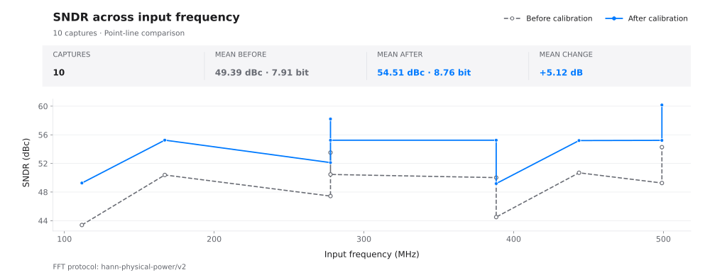
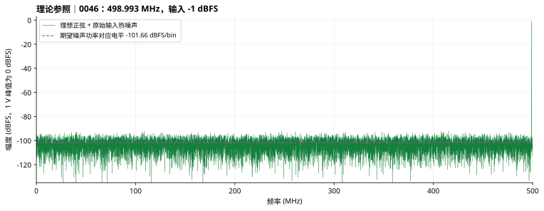

# 快速上手：50 组全频段 ADC 校准实验

[安装说明](installation.zh-CN.md) · [用户手册](user-guide.zh-CN.md) · [配置参考](reference.zh-CN.md) · [English](quick-start.md)

使用配套的 50 组流水线 ADC 数据，依次完成预处理、模型训练和独立测试，学习如何通过频谱与指标判断校准效果。完成后，你将得到一个校准模型及 10 组测试报告。

## 1. 准备软件与数据

按[安装说明](installation.zh-CN.md)解压软件并运行 `KAN Workbench.exe`。使用配套文档目录中的 `examples/fullband50/raw/`；软件包内对应位置为 `Documentation/examples/fullband50/raw/`。数据由随附的 MATLAB 生成脚本生成，模型为一个前5级为2.5bit，最后一级为4bit，级间增益为4的14bit Pipelined ADC。包含固定级间增益误差、DAC 偏差、比较器偏移、三阶非线性和记忆效应，并在量化前加入随机热噪声。各文件使用同一组器件误差。CSV 只提供 ADC 码字，不包含仿真理想输出标签。

| 项目 | 数据规格 |
| --- | --- |
| 采集数量 | 10 个频点 × 5 档幅度，共 50 组 |
| 采样条件 | 单通道、单音、1 GS/s；每组 32768 点 |
| 文件结构 | 无表头，6 列有符号整数；一行对应同一时刻的六级码字 |
| 第 1–5 列 | 五个 2.5-bit 流水线级，码字范围 -4～4 |
| 第 6 列 | 4-bit 后端，码字范围 -8～7 |
| 理想级间增益 | 前五级均为 4 |
| 输入幅度 | -1、-3、-6、-9、-12 dBFS；以 1 V 峰值为 0 dBFS |
| 输入热噪声 | 5 LSB RMS，约 610.35 μV；LSB 按 14 bit、±1 V 定义 |

频点约为 1.007、56.366、111.664、167.023、222.321、277.679、332.977、388.336、443.634、498.993 MHz，覆盖 0–500 MHz 第一奈奎斯特区间内部。每个频点均有五档幅度；精确频率采用相干采样频点，见[数据清单](../examples/fullband50/manifest.json)。

文件名 `PS_f498.993M_A-01.0dBFS_0046.csv` 表示约 498.993 MHz、-1 dBFS、编号 0046。前三行如下：

```text
-4,2,-1,1,1,-3
4,-2,1,-1,0,1
-4,2,-1,1,-1,3
```

## 2. 新建项目并预处理

选择左侧 **新建**，通过 **编辑** 将项目命名为 `ADC校准入门`。进入 **数据** 页，将 **原始数据目录** 指向上述 `raw` 文件夹。也可先复制到长期保存的位置，例如 `C:\ADC-Demo-Fullband-50\data`。

### 数据与校准设置

| 界面字段 | 设置 | 作用 |
| --- | --- | --- |
| 输出格式 | CSV | 保存预处理数值文件 |
| 测试集比例 | 20% | 按完整采集文件留出 10 组，余下 40 组训练 |
| 输入编码 | 有符号十进制 | 正确读取包含负值的级码字 |
| 通道数／输入信号 | 1／单音 | 与仿真采集一致 |
| 原始数据来源／模型输入模式 | 各级码字／各级码字 | 保留六级观测量 |
| 补偿基准来源 | 初始参数合成 | 以理想参数重建输出作为补偿起点 |
| 抽样比例／校准质量 | 100%／专业 | 使用全部采样点执行专业档粗校准 |
| 全部 IGE／全部 DAC | 均开启 | 估计级间增益与 DAC 误差，改善参考信号 |

注：参数具体含义详见[配置参考](reference.zh-CN.md#preprocessing)。

### ADC 结构

设置 **ADC 级数** 为 6，第 1–5 级位宽为 `2.5`，第 6 级位宽为 `4`；前五级 **到下一级增益** 全部填 4，**码字合成** 选择 **按级间增益自动计算**。

可在 **统一级间增益** 中填 `4`，点击 **应用全部**，再核对逐级表格。最后一级为后端，不填写到下一级增益。这里填写理想结构参数，不填写建模定义的失配值。


数据预处理将原始码字整理为模型可用的数据，并通过补偿级间增益和 DAC 等主要误差，生成更准确的训练参考信号。

依次点击 **1. 检查数据 → 2. 开始预处理**。完成后核对 50 个文件、6 列、训练集 40 组、测试集 10 组。修改已检查的设置时，先点击 **重新开始**。

```text
项目目录/outputs/preprocessing/v001/
├─ train_40/
│  ├─ inputs/       归一化的六列模型输入
│  ├─ baseline/     理想参数合成的补偿基准
│  └─ reference/    粗校准信号拟合得到的单音参考
├─ test_10/         测试集的预处理结果，供剪枝验收等使用；常规模型测试选择 raw_test
└─ raw_test/        测试集的原始数据入口，仅保存引用
```

模型学习 `reference - baseline` 的补偿量，测试时输出 `baseline + 模型预测补偿量`。本例以理想参数合成值作为补偿起点，粗校准用于改善参考信号。保持表中的基准选择，才能与后文的校准前后结果对应。

## 3. 配置并训练 KAN

进入 **配置 → 浮点模型 → 模型训练**，核对 **训练数据** 指向本次 `train_40`。按页签填写：

| 页签／字段 | 设置 | 配置依据 |
| --- | --- | --- |
| 数据读取：输入模式 | 各级码字 | 每时刻输入六级码字 |
| 数据读取：采样频率／输入信号 | 1 GHz／单音 | 用于信号处理与频谱标注 |
| 每组读取行数 | 32768 | 读取每组完整采集 |
| 网络设置：窗口数量 | 3 | 使用连续三点，建模时间相关误差 |
| 网络设置：隐藏层 | 5 | 一个含五个节点的隐藏层；字段只填 `5` |
| 网络设置：grid／k | 5／3 | 用五个网格区间的三阶样条拟合平滑非线性 |
| 网络设置：基础函数 | identity | 保留线性分支 |
| 多通道输出使用独立 KAN | 关闭 | 本例只有一个输出通道 |

网络应显示 18→5→1，共 1820 个参数：18 个输入来自 6 列 × 3 点窗口；1 个输出为当前采样点的补偿量。先使用该结构完成流程；更换数据后，再根据验证结果调整窗口和模型规模。

在 **训练设置** 中填写下表。优化器、调度器和早停位于 **训练策略**，设备与精度位于 **运行设置**。

| 字段 | 设置 |
| --- | --- |
| 训练轮数／批大小 | 20／512 |
| 学习率／权重衰减 | 0.001／0.0001 |
| 优化器 | adamw |
| 标准化补偿目标 | 开启 |
| 调度器／余弦周期／最低学习率 | cosine／20／0.000001 |
| β1／β2／ε | 0.9／0.999／0.00000001 |
| AMSGrad／启用早停 | 均关闭 |
| 计算设备／数值精度 | 自动／自动 |
| 随机种子 | 1 |
| 评估记录 | 关闭训练后评估及逐轮频谱 |

目标标准化缩放补偿量，便于优化；余弦调度在后期减小更新步长；权重衰减提供轻度参数约束。先按 20 轮完成训练，再通过独立测试检查效果。

点击 **开始训练**。在 **训练** 页确认实际设备与精度，等待 **训练完成**，20/20。通过 **打开目录** 找到 `checkpoints/best.pt`，下一步使用该模型测试；`last.pt` 用于继续训练。

## 4. 测试 10 组留出采集

在已完成的训练页点击 **模型测试**，或进入左侧 **测试** 页并展开输入区。

1. **测试模型**：通过当前训练任务的 **打开目录**，选择其中的 `checkpoints/best.pt`。目录版本号以实际任务为准。
2. **原始采集数据目录**：选择本次预处理的 `raw_test`，表示选择预处理时分离出的10组测试集进行测试，也可以选择任意同预处理前相同格式的原始数据进行测试。
3. **输入信号／每组读取行数**：单音／32768。采样率与 ADC 参数随模型读取。
4. 点击 **开始测试**，确认完成状态为 10 组数据。

## 5. 读取结果与噪声参照

校准前后均使用 32768 点、周期 Hann 窗、1 GS/s、0–500 MHz 带宽。先核对基波位置与幅度，再比较谐波、杂散和噪底。SNDR 计入噪声与失真，SFDR 反映最大杂散。


以下为配套数据的 10 组参考结果，使用上述配置及 CUDA／float64 运行。输入幅度为仿真器设置；SNDR 单位为 dB，SFDR 单位为 dBc（相对基波）。随机分集和计算环境可能导致你的结果有所差异，应逐组检查改善情况。

| 采集 | MHz | 输入 dBFS | SNDR 前 → 后（dB） | SFDR 前 → 后（dBc） |
| --- | ---: | ---: | ---: | ---: |
| 0015 | 111.664 | -12 | 43.39 → 49.26 | 48.62 → 73.58 |
| 0018 | 167.023 | -6 | 50.38 → 55.25 | 56.05 → 80.53 |
| 0027 | 277.679 | -3 | 53.52 → 58.21 | 60.70 → 86.62 |
| 0028 | 277.679 | -6 | 50.46 → 55.24 | 56.18 → 82.48 |
| 0029 | 277.679 | -9 | 47.43 → 52.11 | 55.12 → 78.96 |
| 0038 | 388.336 | -6 | 50.02 → 55.25 | 56.14 → 84.63 |
| 0040 | 388.336 | -12 | 44.50 → 49.18 | 50.29 → 79.17 |
| 0043 | 443.634 | -6 | 50.69 → 55.20 | 56.12 → 77.17 |
| 0046 | 498.993 | -1 | 54.28 → 60.17 | 62.55 → 84.22 |
| 0048 | 498.993 | -6 | 49.26 → 55.22 | 56.04 → 76.15 |

平均 SNDR 为 49.39→54.51 dB；逐组提升 4.50–5.96 dB，SFDR 提升 20.12–28.89 dB。同频点的不同幅度对应不同信噪比，不能将它们视为同一幅度下的频率响应曲线。完整配置与数值见[实验记录](../examples/fullband50/experiment.json)和[结果 CSV](../examples/fullband50/test-results.csv)。



### 校准目标与噪底

校准可减小 ADC 的失真，但不能消除输入中的随机噪声。

仅考虑输入热噪声时，0046 组的信噪比约为 60.28 dB。校准后 SNDR 为 60.17 dB，已接近这一水平。



## 6. 保存实验

保留原始数据、完整项目目录、训练模型及配套配置、测试报告。`raw_test` 引用的 **原始文件须保持可访问**；迁移方法见[保存、继续与迁移](user-guide.zh-CN.md#backup)。

**完成标准**：40/10 分集正确；训练完成 20 轮；测试报告包含 10 组；模型、指标及频谱均可打开。任务目录中的 `test_summary.json`、`fft_summary.csv` 与 `groups/` 用于逐组复查。重复实验使用对应版本目录，不混用不同任务的模型或测试入口。

模型搜索、剪枝、量化以及硬件实现详见[用户手册](user-guide.zh-CN.md#optimization)。
