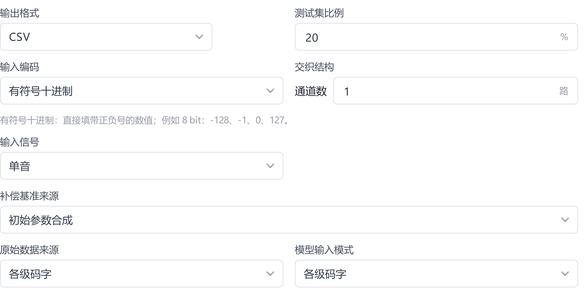
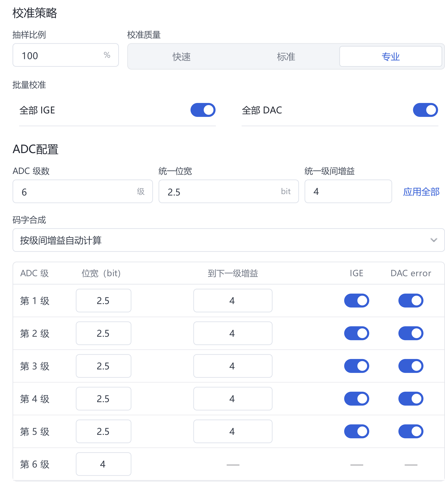
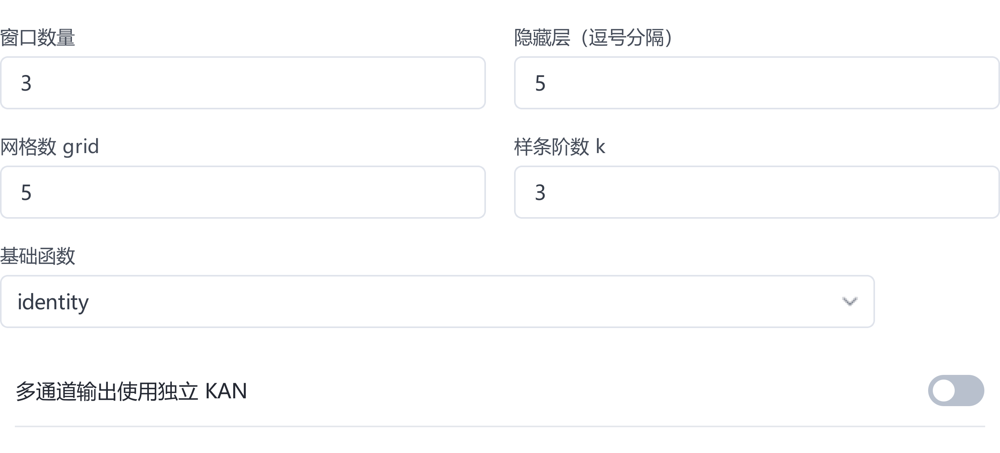
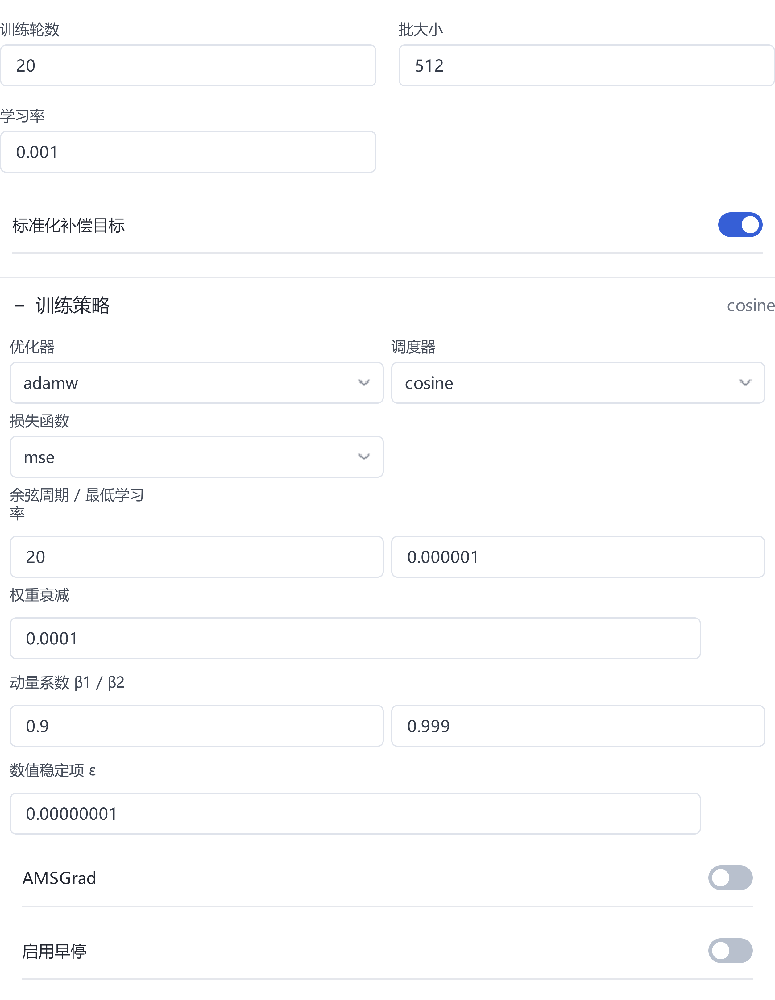
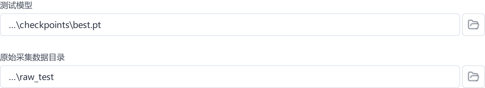
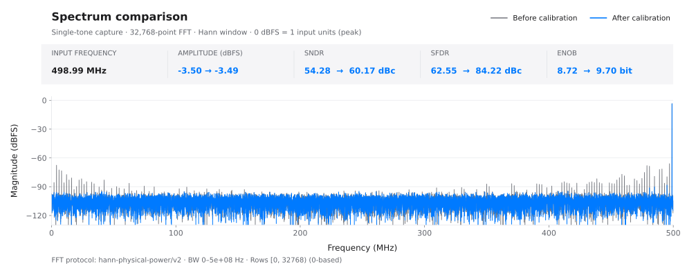

# 用户手册

[首页](../README.zh-CN.md) · [快速上手](quick-start.zh-CN.md) · [配置参考](reference.zh-CN.md) · [排错](troubleshooting.zh-CN.md)

本手册说明 ADC 校准的操作流程、配置方法与评估标准。首次使用请先完成[快速上手](quick-start.zh-CN.md)；参数定义见[配置与功能参考](reference.zh-CN.md)。

## 1. 工作流程与基本概念

### 项目、任务、模型和报告

**项目**管理配置、任务和结果。**任务**对应一次预处理、训练、测试或优化；修改实验条件时新建任务，保留原结果供比较。**模型**包含权重和输入输出约定，使用时需保留所需的预处理配方、浮点参照等关联文件。**报告**记录模型在指定数据与条件下的评估结果。

创建项目并选择可写目录，然后进入 **数据** 页。软件、项目与原始采集分目录存放，原始采集保留只读副本。项目可能引用外部文件，备份时须一并保存引用目标。

| 阶段与入口 | 输入 | 目标与产物 |
| --- | --- | --- |
| 数据：预处理 | 原始码字、ADC 规格、信号类型 | 检查编码与结构，划分采集，生成输入、基准、参考和配方 |
| 配置、训练：浮点模型训练 | 完整训练目录、网络与训练设置 | 学习补偿关系，保存检查点、配置和训练记录 |
| 测试：独立评估 | 模型及关联文件、独立原始采集 | 应用固定预处理参数，输出校准前后频谱与逐组指标 |
| 模型优化、硬件 | 已验证模型、验证数据及所需工具 | 在精度约束下压缩模型，评估定点与数字实现 |

### 输入、基准与参考

| 数据角色 | 含义 | 核对内容 |
| --- | --- | --- |
| 模型输入 `inputs` | 各级码字或合成输出码字 | 列顺序、通道顺序、窗口及编码与模型一致 |
| 补偿基准 `baseline` | 与模型补偿量合成的校准前输出 | 采用初始参数或粗校准参数；幅度尺度明确 |
| 目标参考 `reference` | 按信号类型拟合的训练目标 | 拟合适用，未受格式错误或严重失真影响 |

目录兼容名称 `code`、`actual`、`ideal` 分别对应上述角色。拟合参考并非独立测量的真实输入；损失衡量对参考的拟合程度，校准效果以独立采集的评估结果为准。

## 2. 准备自己的 ADC 数据

### 文件格式与采集记录

准备原始 CSV/TXT、ADC 规格及采集记录，在 **数据** 页选择原始目录。

每份文件对应一组连续采集，每行对应一个采样点。CSV 用逗号分隔，TXT 用空白分隔。文件只保留码字，不含表头、时间戳、序号或单位；整数码字不得含小数、空值、NaN 或 Inf。固定宽度二进制须选择对应编码入口。

| 数据形式 | 配置 | 核对内容 |
| --- | --- | --- |
| 各级整数码字 | 选择“各级码字”，填写级数、位宽、名义级间增益与编码 | 每列对应一级，列顺序与允许码域正确 |
| 最终 ADC 整码 | 选择“最终输出码字”，填写输出位宽及有符号／无符号编码 | 每行一个码字，无需内部级间增益 |
| 同一码字按位拆列 | 选择补码二进制输入，最高位在前，每列仅 0/1 | 每列位宽为 1，按位列解释而非物理级 |
| 多路交织采集 | 填写通道数，按 lane 0 至 lane L−1 循环逐行排列 | 按完整交织帧组织，区分通道数与级数 |

demo 的六列对应五个 2.5-bit 级和一个 4-bit 后端，前五列码域为 −4～4，末列为 −8～7。“2.5 bit”表示级结构，文件内仍为整数；其他 ADC 按实际规格确定码域。

各级码字选择“偏移二进制”时，每列为对应位宽的固定 N 位 0/1 字符串，中间码表示零。例如 8 位 `10000000` 表示 0。最终输出入口的无符号十进制整码采用另一种表示方式，详见[输入参考](reference.zh-CN.md#data)。

采集记录应包含文件编号、仿真／实测来源、器件与通道、采样率、频率与幅度、满量程、样本数、温度、供电及批次。仿真另存误差模型、参数和随机种子；实测记录信号源、时钟及前端设置。幅度注明峰值、峰峰值或 RMS；使用 dBFS 时注明基准。

总采样率按合并输出序列填写：两路各 700 MS/s 的交织输出为 1.4 GHz。双音频率提示使用 `f/fs`，如 100 MHz 信号、1 GHz 采样率填写 `0.1`。

### 检查数据

1. 选择原始目录，按 ADC 规格配置数据来源、编码、通道数和级结构。
2. 点击 **检查数据**，核对文件数、列数、有效行数、码域及识别信号。
3. 对照采集记录检查符号、通道顺序和饱和情况。

检查通过且识别结果一致后，可进入预处理。格式检查不覆盖模拟前端、时钟或采集质量；列数、越界错误先检查格式与编码，拟合警告先检查信号类型、码字合成及采集质量。

### demo 的数据与误差条件

全频段 demo 包含同一仿真器件的 50 组单音采集：10 个频点覆盖约 1～499 MHz，搭配 −1、−3、−6、−9、−12 dBFS 五档幅度；采样率 1 GS/s，每组 32768 点。误差包括级间增益、DAC 电平、比较器偏移、三阶非线性、记忆项及 5 LSB RMS 输入热噪声。

生成脚本基于 `generate_pipelined_single_tone.m`，仅将频点数改为 10、目标范围改为 1～499 MHz；幅度、噪声、器件误差和随机种子沿用原设置。各组共用固定器件失配，未模拟时钟抖动、温漂及器件间差异。精确参数见[样例说明](../examples/fullband50/README.md)与[数据清单](../examples/fullband50/manifest.json)。

## 3. 预处理与数据划分

### 划分训练、验证与最终测试数据

拟合粗校准参数和训练网络前，按完整文件或采集批次划分数据。同一连续记录的相邻窗口高度相关，应归入同一集合。

| 数据用途 | 使用范围 | 隔离要求 |
| --- | --- | --- |
| 训练集 | 估计粗校准参数、训练网络权重 | 与最终测试采集隔离 |
| 验证集 | 选择窗口、网络、轮数、剪枝阈值及位宽 | 用于方案选择，不作为最终独立结论 |
| 最终测试集 | 方案固定后报告性能 | 全程不参与拟合、模型选择或调参 |

**测试集比例**只生成训练与留出两部分。需要调参时，先在软件外保留最终测试目录，再将其余数据划分为训练与验证集。此时 `raw_test` 用于验证，并在实验记录中注明；最终测试使用预留的原始目录。

快速上手按 20% 留出得到 40 组训练、10 组测试。粗校准的 39 组拟合与 1 组验收均在训练侧，不替代网络验证。若需评估跨频率、幅度、温度或器件的泛化能力，应按对应条件留出采集。

### 配置码字合成、IGE、DAC 与补偿基准

在 **数据** 页按名义 ADC 规格配置码字合成，将检查通过的采集转换为一致的输入、基准与参考。

| 设置 | 作用与选择依据 |
| --- | --- |
| 级数、各级位宽 | 定义各列结构与码域，与实际 ADC 对应 |
| 名义级间增益 | 确定初始合成权重，填写设计值 |
| 按级间增益自动计算 | 根据已知流水线结构计算权重 |
| 自定义每通道每列权重 | 根据已知列权重关系配置；检查数据后扫描初始权重，并核对按软件规则取到 2 的整数次幂后的值 |
| 全部 IGE | 估计适用级的级间增益误差，要求结构与信号模型适用 |
| 全部 DAC | 估计适用级的 DAC 电平误差，需检查数据覆盖与拟合验收 |
| 初始参数合成 | 以名义重建输出为补偿基准，评估总校准改善 |
| 粗校准后合成 | 以粗校准最终接受或回退参数为基准，网络补偿剩余误差 |

IGE、DAC 与补偿基准分别配置。启用粗校准后，仍需选择基准来源，并检查参数接受、拒绝或回退状态。最终输出码字模式按输出规格配置，无需内部级结构。

### 执行预处理

1. 设置测试集比例、抽样比例、校准质量及补偿基准。对照实验复用同一划分；重新检查可能改变随机划分。
2. 执行 **检查数据 → 开始预处理**；自定义权重模式增加 **扫描初始权重** 步骤。
3. 修改已锁定设置时，选择 **重新开始** 后重新检查。单音拟合要求确认时，先复核编码、名义增益和信号质量。
4. 完成后核对分集编号、粗校准状态及输出文件。确认任务成功、组数正确、角色文件配对完整、配方可读取后再训练。

| 产物 | 用途 |
| --- | --- |
| `train_N` | 完整训练根目录，N 为训练采集数 |
| `test_M` | 留出采集的预处理结果，用途由验证／测试划分决定 |
| `raw_test` | 留出原始采集的测试入口，可能仅保存原始文件引用 |
| `inputs`、`baseline`、`reference` | 按采集编号配对的输入、补偿基准与参考；训练时选择其上层完整目录 |
| `adc_config.json` 与预处理配方 | 保存编码、结构、重建及测试所需信息，随数据和模型保留 |

测试比例为 0% 时，训练角色目录直接位于结果根目录；最终输出模式可能只生成 `inputs` 与 `reference`。缺少 `train_N` 时检查测试比例，`raw_test` 失效时检查原始文件引用。

## 4. 配置和运行训练

### 选择输入与网络结构

准备完整训练目录和独立验证采集，进入 **配置 → 浮点模型 → 模型训练**。以满足指标的最小模型为目标，逐项比较配置。

在 **数据读取** 中核对输入模式、训练根目录、总采样率、信号类型及每组读取行数。读取行数 `0` 表示全部，非零值限制每组长度；窗口控制时间上下文，批大小控制每次参数更新的样本数。

| 网络设置 | 作用 | 选择依据 |
| --- | --- | --- |
| 窗口数量 | 每次预测使用的相邻采样点数 | 静态误差可从 1 开始；有记忆效应时比较 3 等短窗口 |
| 隐藏层 | 各层节点数，多层用逗号分隔 | 从少节点、单隐藏层开始，扩容前排除数据与参考错误 |
| 网格数 grid | 样条分段细度 | 从粗网格开始，按验证收益决定是否细化 |
| 样条阶数 k | 样条多项式阶数 | 从低阶开始，按验证效果调整 |
| 基础函数 | KAN 基础分支的函数形式 | 固定起点，需要时做单变量比较 |
| 多通道输出使用独立 KAN | 每个分支只接收对应 lane 的级码 | 按通道耦合及部署要求选择，并检查量化兼容性 |

可用单隐藏层 2 个节点、grid 1、k 2 作为待验证的小模型起点，窗口按误差记忆性选择。验证集仍有系统性残差时，再比较节点数、网格或窗口；仅保留带来稳定收益的扩容。

该配置形成 18→5→1 结构，共 1820 个参数，未验证为最小结构。六列、单通道、三点窗口对应 6×3=18 个输入；其他模式以软件结构预览为准。

### 训练策略与运行设备

在 **训练设置** 中填写轮数、批大小、学习率及目标标准化，展开 **训练策略** 和 **运行设置** 核对其余参数。

| 设置 | 作用与选择依据 |
| --- | --- |
| 学习率、优化器 | 控制参数更新；损失振荡或发散时降低学习率，并核对输入与目标尺度 |
| 训练轮数 | 限定训练预算，按验证表现选择 |
| 批大小 | 控制更新批次与显存占用；显存不足时逐步减半 |
| 调度器 | 调整学习率；余弦周期与计划轮数配套设置 |
| 权重衰减 | 约束权重规模，通过固定划分的对照确定 |
| 标准化补偿目标 | 调整目标量级；比较损失前核对标准化状态与输出尺度 |
| 早停 patience、min delta | 按训练损失改善决定是否停止，阈值随目标尺度设置 |
| 设备、精度、随机种子 | 确定运行环境与初始化；使用 `auto` 时确认实际设备 |

兼容 NVIDIA GPU 可选 `cuda`，启动后确认实际设备与精度。demo 使用 CUDA、float64。对照实验固定随机种子并记录运行环境；跨设备或重新分集可能改变结果。

### 启动、停止与继续训练

1. 进入 **训练 → 开始新训练**，核对任务、目录、结构摘要及实际设备。
2. 观察损失是否有限、轮数是否推进、学习率是否按计划变化，分别记录训练损失与验证指标。
3. 点击 **安全停止** 后，等待当前轮完成并保存状态；兼容中断任务可用 **继续剩余训练** 恢复。
4. 追加轮数时，选择 **继续训练…**，加载原任务的 `last.pt` 并填写追加轮数。结构或数据改变时新建任务。

任务完成或正常早停后，核对以下产物：`checkpoints/best.pt` 按训练损失选择；`checkpoints/last.pt` 保存续训状态。保留 `config_resolved.yaml`、`run_info.json`、`run_manifest.json`、`metrics.csv` 和 `run.log`。

损失比较须使用一致的标准化状态、输出尺度与单位。标准化 MSE 不能与未标准化值直接比较；写为 V² 前须完成电压换算。过拟合判断需结合独立验证。

**评估记录 → 训练后评估当前数据**使用已载入数据，不会自动执行独立测试。用于选择轮数的 SNDR/SFDR 属于验证结果；最终评估在 **测试** 页执行。

## 5. 独立测试与结果解读

### 固定模型与测试条件

方案确定后，使用未参与训练或调参的原始采集评估性能。准备模型及关联文件、独立采集和采集记录，进入 **测试** 页。

1. 在 **测试模型** 中选择 `best.pt` 或指定模型，核对摘要、输入模式、通道数及关联配方。
2. **原始采集数据目录**选择 `raw_test` 或预留的兼容原始目录。测试沿用模型关联的预处理参数，最终测试集不参与参数重拟合。
3. 核对采样率，选择单音／双音，按需填写双音频率提示，设置每组读取行数及保存位置。
4. 点击 **开始测试**。结束后核对成功、失败和跳过组数，确保覆盖预期采集。**安全停止**在当前组完成后生效，兼容中断任务可用 **继续剩余测试** 恢复。

测试读取行数独立设置，交织数据按完整帧对齐，实际 FFT 点数受文件长度影响。比较时固定采样率、读取范围、FFT 点数、窗函数、带宽、信号模式及幅度标尺。软件评估完整序列，窗口未覆盖的边界点可能沿用基准，具体范围见报告。

确认各组结果完整后，通过 **打开目录** 保存 `test_summary.json`、`fft_summary.csv`，以及 `groups/` 内的 `fft_metrics.json`、`predictions.csv` 和频谱 SVG。模型或配方不匹配时，从原任务恢复关联文件。

### 联合分析指标与频谱

在 **单组 FFT** 中比较校准前后曲线，在 **全部数据组指标** 中检查频率与幅度覆盖。同时记录均值、最差组和退化组。

| 指标或现象 | 含义 | 核对内容 |
| --- | --- | --- |
| SNDR 提升 | 噪声与失真相对信号减小 | 同一采集、带宽及幅度条件下是否存在局部退化 |
| SFDR 提升 | 最大杂散相对信号减小 | 最大杂散、谐波及交织相关分量的位置与变化 |
| ENOB | 由信噪失真性能换算的有效位数 | 幅度与单音条件；双音不套用标准单音公式 |
| 杂散下降、噪底近似不变 | 可重复失真减小，随机噪声仍存在 | 积分指标与频谱是否一致 |
| 损失下降、独立指标不升 | 拟合改善未转化为校准收益 | 参考偏差、过拟合、分布及评估条件变化 |

[查看 SVG 原图](../assets/fullband50/capture_0046-spectrum.svg)。图中采用 32768 点周期 Hann 窗、1 GHz 采样率、0～500 MHz 分析带宽；频谱协议详见对应报告。

### 噪底、理论参照与适用范围

补偿确定性失真不会自动消除输入热噪声。FFT 点数、窗函数、带宽和归一化均影响显示噪底。若噪底异常下降，先对齐幅度标尺、读取范围与频谱协议，再排查滤波、频点剔除和数据泄漏。

demo 理论参照以 1 V 峰值为 0 dBFS，软件图使用归一化重建值，两者约差 2.50 dB，比较前须统一标尺。理论参照仅含理想正弦与输入热噪声，未计入量化及残余转换误差；换算与理论图见[频谱说明](../examples/fullband50/README.md)。

demo 的 10 组留出采集获得 4.50～5.96 dB SNDR 改善、20.12～28.89 dB SFDR 改善，适用范围限于该仿真器件及所列采集条件。过拟合仍需通过独立噪声重复采集检验；更换频率、幅度、温度、时钟或器件后重新验证。

## 6. 改善校准效果

### 排查性能瓶颈

固定基准模型与验证数据，按下表定位原因；每次只改变一个因素并新建任务。

| 顺序 | 检查位置与内容 | 判断依据 |
| --- | --- | --- |
| 1. 数据与 ADC 结构 | 数据页：编码、列序、位宽、增益及交织顺序；采集记录：饱和、缺样、时钟及幅度 | 格式符合规格，名义输出频谱合理 |
| 2. 基准与参考 | 预处理记录：信号模式、基准来源、粗校准状态及拟合警告 | 参考适用，基准明确，配方可追溯 |
| 3. 训练状态 | 训练页及日志：有效样本、设备、损失、学习率及目标尺度 | 排除发散、目录错误和任务未完成 |
| 4. 模型容量 | 固定验证集比较短窗口、少节点及粗网格 | 扩容有稳定收益才保留 |
| 5. 独立验证 | 测试页：各幅度、频率与新采集的结果 | 记录退化与失效条件，方案确定后评估最终测试集 |

训练误差下降而验证指标停滞或下降时，比较减小容量、减少轮数、调整正则化及增加独立采集的效果。训练与验证均不佳时，先排除输入和参考错误，再判断是否欠拟合。

### 公平比较参数方案

对照前固定原始文件及散列、划分、配方、读取范围、采样率、信号模式、FFT 条件、种子和训练预算。比较窗口时，记录随之变化的有效样本数与模型参数量。

每个方案保存结构、参数量、训练时长、逐组 SNDR/SFDR、最差组、退化组及验收状态。同频率、不同幅度分别比较；接近的结果用不同初始化或新的同条件采集复核。

按预设指标选择较小方案，并保存比较依据。搜索、剪枝验收、位宽选择或人工调参使用的数据均属于验证集。最终测试后继续调参时，须另留未使用的采集作最终评估。

## 7. 模型优化与硬件流程

浮点模型通过验证后，按部署目标选择结构压缩、量化及硬件实现。各阶段分别验收，保留其输入、配置与结果。

### 模型搜索

在 **配置 → 浮点模型 → 模型搜索** 中指定训练数据、验证目录、SNDR/SFDR 下限及时间预算，按需调整高级设置后启动。搜索采用独立的训练阶段与预算。

“频点平均达标”先在频点内求平均，再对各频点求平均，两项指标均须达到阈值；“每组都达标”要求每份采集均达标。按评估目标选择，并检查最差组。

完成后保存候选结构、搜索状态、验收结果及模型，再对选定方案独立测试。搜索结果受时间预算限制，不代表全局最小结构；无合格候选时记录未达标。异常停止后保留任务，按界面提示恢复。

### 模型剪枝

在 **测试 → 模型剪枝** 中选择已验证模型、验证目录及读取范围，设置 SNDR/SFDR 增益保留目标。运行后检查逐组验收与连接数；需恢复精度时执行剪枝训练并复测。

“增益保留”按原模型相对未校准基准的指标改善计算。例如指标由 60 提升至 80 dB，保留 90% 增益要求至少 78 dB，与连接保留比例无关。

确认剪枝结果被接受且验证达标后，保存来源模型、剪枝模型／训练种子、规模统计、验收及后续训练记录。

### 位宽扫描与量化训练

准备兼容浮点模型、完整训练数据、验证数据及预处理配方。在量化配置中通过 **位宽扫描** 选择并应用候选，或直接指定方案，再运行量化感知训练（QAT）及最终验收。

QAT 支持**单隐藏层共享网络**，运行前先检查结构兼容性。位宽候选与训练损失仅用于选型和训练，最终按量化验收状态、相对浮点基准的性能差及独立测试判断。

保存位宽方案、量化模型、浮点参照、配方、训练及验收报告；缺少关联文件时，从完整来源任务恢复。

### RTL 与 ASIC

在 **硬件 → 仿真与综合** 中选择兼容模型与输出接口：补偿值输出提供校正量，校准值输出提供完整校准结果。准备所需工具、许可、测试数据与约束，选择导出、仿真对拍或综合流程。

| 阶段 | 验收与归档 | 结果范围 |
| --- | --- | --- |
| RTL 导出 | 源码、参数及接口说明生成成功 | 仿真、精度与综合需另行验证 |
| 仿真与逐码比较 | 数字输出比较及精度检查通过 | 以实际测试向量和覆盖范围为准 |
| 综合 | 保存网表、资源／面积、时序及约束报告 | 是否满足目标时钟以时序报告为准 |
| ASIC 逻辑与物理实现 | 扩展自检及所选综合、布局布线、验证阶段通过 | 分别记录未运行或未通过的阶段 |
| 功耗评估 | 保存工艺、活动输入、覆盖率及报告 | 仅代表指定条件下的实现功耗估计 |

ASIC 流程先在 **管理 ASIC 扩展** 中安装、导入或连接兼容环境并完成自检，再执行逻辑综合、物理实现及适用的功耗评估。工具要求见[硬件参考](reference.zh-CN.md#hardware)。对照时固定工艺、时钟、接口、输入活动与验证范围。

失败、取消或超时后保留任务，定位阶段并恢复兼容检查点。模型、工具、工艺或约束改变时重跑受影响阶段，未执行项记录为未评估。

## 8. 保存、复现与迁移

### 保存完整实验

通过项目及任务的 **打开目录** 定位结果，任务完成后备份以下材料。

| 材料 | 保存内容 |
| --- | --- |
| 原始采集与用途清单 | 训练、验证、最终测试文件及外部引用目标；采集条件、编号和散列 |
| 完整项目目录 | 项目记录、任务请求、配置、归档输入、预处理产物及配方 |
| 模型及关联文件 | best／last 检查点、剪枝或量化结果、浮点参照及匹配配置 |
| 结果与日志 | 逐组预测、频谱原图、汇总指标、验收状态及日志 |
| 环境记录 | 软件及发行包、GPU／驱动、实际设备与精度、外部工具及工艺版本 |

续训、量化及硬件验证可能依赖来源任务。保存完整任务及关联文件，保留被引用的原始目录。

### 复现与迁移

1. 准备匹配的软件环境、项目副本及原始采集，在软件中打开项目。
2. 核对外部引用、模型摘要及配套文件，修复失效路径。
3. 复用原划分与配方，按原模型和评估条件先测试一组，再完整复测并比较逐组指标。
4. 重新训练时使用保存的配置与种子，将结果写入新任务并记录环境差异。
5. 验证副本后再清理旧目录。升级采用新目录并先验证项目副本，回退使用原软件与升级前备份。

迁移完成须满足数据可读取、模型可加载、评估条件一致，且结果差异可解释。重新训练允许数值差异，但数据、配置、环境及评估协议须可追溯。

## 9. 常见问题与求助

保留任务与错误文本，按下表定位故障。安装与硬件问题另见[常见问题与排错](troubleshooting.zh-CN.md)。

| 现象 | 检查与处理 |
| --- | --- |
| 数据检查失败 | 核对分隔符、表头、列数、非有限值、编码与位宽 |
| CUDA 不可用或实际为 CPU | 检查 GPU 识别、驱动与运行库兼容性及设备设置，见 [GPU 排错](troubleshooting.zh-CN.md#gpu) |
| 显存不足 | 批大小逐步减半，再评估模型与窗口；新建任务并记录修改 |
| 训练不收敛或损失非有限 | 先核对文件配对、参考、目标尺度及学习率 |
| 损失下降但测试指标下降 | 检查数据隔离、采样率、读取范围、频谱条件及分布变化，按第 6 章比较容量与轮数 |
| 配方缺失或模型不匹配 | 恢复原任务关联文件，核对输入模式、结构、通道数及编码 |
| 继续训练失败 | 使用原任务的 `last.pt` 并核对配置；结构或数据改变时新建任务 |
| 移动后找不到原始数据 | 检查外部引用；`raw_test` 可能不含数据副本，须恢复原始文件 |
| 搜索、剪枝或量化未达标 | 分别检查候选、训练及最终验收状态，保留失败原因 |

任务记录通常位于 `tasks/<任务编号>/`，含 `task.json`、`request.json`、`events.jsonl` 及相关配置。训练问题保留 `run.log`、`run_manifest.json`、`metrics.csv`；测试问题保留 `test_summary.json` 和对应组报告。具体位置通过 **打开目录** 查看。

反馈请附软件与系统版本、GPU／驱动、操作页面、复现步骤、预期与实际结果、错误原文、配置及日志。demo 问题注明采集编号、划分与修改项。截图保留关键字段，隐去个人路径及敏感信息。问题反馈见 [CONTRIBUTING](../CONTRIBUTING.md)，敏感问题使用[安全报告入口](../SECURITY.md)。
