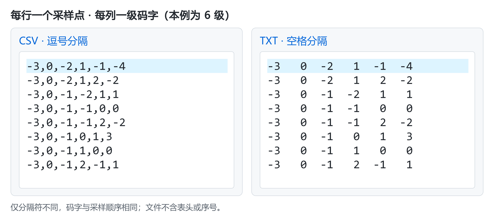
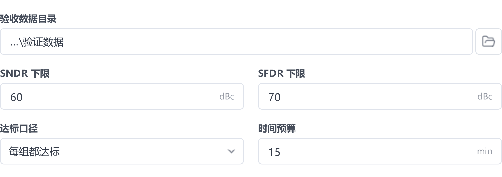
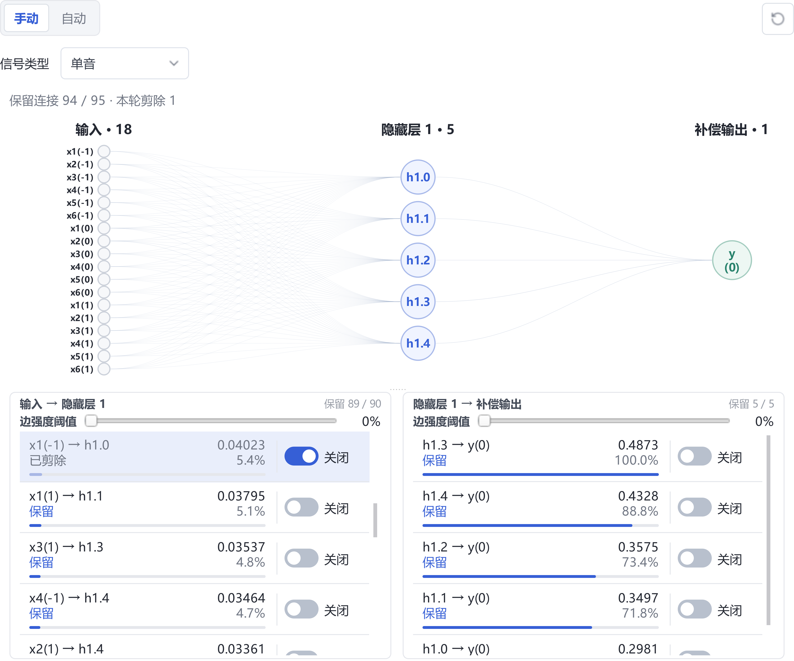
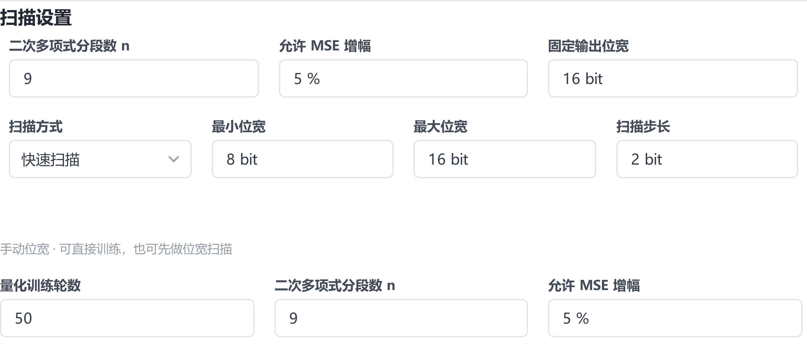
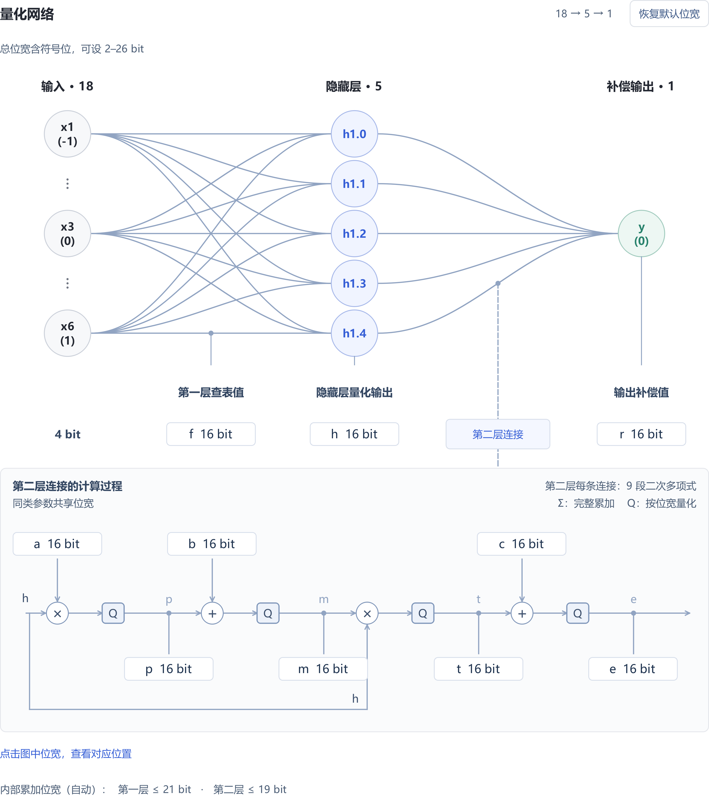

# 用户手册

[首页](../README.zh-CN.md) · [快速上手](quick-start.zh-CN.md) · [配置参考](reference.zh-CN.md) · [排错](troubleshooting.zh-CN.md)

本手册介绍使用自有 ADC 数据进行校准、评估与模型优化的方法。首次使用请先完成[快速上手](quick-start.zh-CN.md)，完整参数定义见[配置参考](reference.zh-CN.md)。

## 1. 工作流程与基本概念

创建项目后，依次完成数据预处理 → 模型训练 → 独立测试。效果达标后，再按部署需求进行模型压缩和硬件验证。

| 阶段 | 操作入口 | 目标 |
| --- | --- | --- |
| 预处理 | 数据 | 检查原始码字，配置 ADC 结构，生成训练数据 |
| 训练 | 配置 → 浮点模型 → 模型训练 | 学习 ADC 的误差补偿关系 |
| 测试 | 测试 | 用独立采集比较校准前后的频谱与指标 |
| 优化与部署 | 模型搜索、剪枝、量化、硬件 | 在满足精度要求的前提下减小实现规模 |

修改实验条件时新建任务，保留原结果供比较。

校准涉及三类数据：

| 数据 | 用途 |
| --- | --- |
| 模型输入 | 送入模型的各级码字或最终输出码字 |
| 补偿基准 | 校准前的重建输出，与模型补偿量相加得到校准结果 |
| 目标参考 | 从采集信号拟合得到，用于训练模型 |

训练损失衡量模型对参考的拟合程度，校准效果由独立测试判断。

## 2. 准备自己的 ADC 数据

### 数据格式

每份文件保存一组连续采集，每行对应一个采样点。CSV 用逗号分隔，TXT 用空白分隔；文件只保存码字，不添加表头、时间戳或序号列。

| 数据形式 | 如何排列 | 如何配置 |
| --- | --- | --- |
| 各级码字 | 每列对应一级 ADC | 选择“各级码字”，填写级数、位宽、编码和理想级间增益 |
| 最终输出码字 | 每行一个完整输出码字 | 选择“最终输出码字”，填写输出位宽与编码 |
| 多路交织数据 | 按 lane 0 至 lane L−1 循环逐行排列 | 填写通道数，使用合并后的总采样率 |

图中数据来自六级流水线 ADC 仿真，六列依次对应五个 2.5-bit 级和一个 4-bit 后端。二进制及其他输入格式见[数据格式参考](reference.zh-CN.md#data)。

若使用最终输出码字，每行可填写一个十进制整数或固定 N 位二进制字符串；二进制须保留前导零。程序按 MSB 到 LSB 自动拆成 N 列，模型也按位输入，与手动拆列一致；有符号码字按补码解释。详细范围和例子见[最终输出码字](reference.zh-CN.md#final-output-codes)。

此模式在右侧使用 **自定义列权重**，默认依次为 `1、0.5、0.25……`。先完成 **检查数据 → 扫描初始权重**，再开始预处理。后续原始数据测试会沿用模型保存的格式自动拆位。

采样率按实际数据填写。交织数据使用合并后的总采样率，如两路各 700 MS/s 对应 1.4 GHz。

### 导入与检查

1. 在 **数据** 页选择原始目录，设置 **数据来源**、**编码**、**通道数** 和 ADC 结构。
2. 点击 **检查数据**，核对文件数、列数、有效行数及码字范围。
3. 确认识别结果符合采集规格，且数据无空值、非法码字或明显饱和，再进入预处理。

## 3. 预处理与数据划分

### 划分数据

按完整采集文件划分数据，避免同一连续记录的相邻窗口进入不同集合。

| 集合 | 用途 |
| --- | --- |
| 训练集 | 估计粗校准参数、训练模型 |
| 验证集 | 选择网络结构、训练轮数和优化参数 |
| 最终测试集 | 方案确定后评估性能，不参与训练或调参 |

软件按 **测试集比例** 划分训练与留出数据。需要反复调参时，先单独保留最终测试目录，再把其余数据划分为训练集和验证集；此时 `raw_test` 用于验证。

### 配置 ADC 与补偿基准

在 **数据** 页按 ADC 规格设置以下参数：

| 参数 | 配置依据 |
| --- | --- |
| 级数、各级位宽 | 与数据列及实际级结构对应 |
| 理想级间增益 | 填写设计值，用于计算初始码字合成权重 |
| IGE、DAC | 分别估计级间增益误差与 DAC 电平误差 |
| 初始参数合成 | 以理想参数重建的输出为基准，评估整体校准改善 |
| 粗校准后合成 | 以粗校准输出为基准，由网络补偿剩余误差 |

**IGE**、**DAC** 与 **补偿基准** 分别设置。预处理完成后检查粗校准验收结果。

以上级结构参数用于各级码字。最终输出码字使用 **自定义列权重**，无需填写各级增益；“**粗校准后合成**”采用已接受的精确权重，“**初始参数合成**”将权重按原有规则取最近的 2 的整数次幂。

### 执行预处理

1. 核对 **测试集比例**、**抽样比例**、**校准质量** 与 **补偿基准**。
2. 执行 **检查数据 → 开始预处理**；自定义权重时先执行 **扫描初始权重**。
3. 完成后确认任务成功、分组数量正确，再打开输出目录。

训练时选择完整的 `train_N` 目录；测试时选择对应的 `raw_test`。保留整个预处理目录及配方，供后续训练和测试使用。

## 4. 配置和运行训练

### 选择输入与网络

进入 **配置 → 浮点模型 → 模型训练**，在 **数据读取** 中选择训练目录，核对 **输入模式**、**采样率**、**信号类型** 和 **每组读取行数**。读取行数填 `0` 表示全部。

从单隐藏层、少量节点、短窗口和粗网格开始，以验证效果决定是否增加容量。

| 参数 | 作用与选择方法 |
| --- | --- |
| 窗口数量 | 控制每次预测使用的相邻采样点数；静态误差可从 1 开始，有记忆效应时比较 3 等短窗口 |
| 隐藏层 | 控制节点数；优先单隐藏层，验证仍有系统性残差时再逐步增加 |
| 网格数 grid | 控制样条分段细度；网格越细，容量与计算量越大 |
| 样条阶数 k | 控制样条阶数；一般建议使用 2 或 3 |

### 设置训练参数

| 参数 | 配置建议 |
| --- | --- |
| 学习率 | 损失振荡或发散时先降低，并检查输入与目标尺度 |
| 训练轮数 | 根据验证结果选择，避免只追求训练损失下降 |
| 批大小 | 根据显存设置，显存不足时逐步减半 |
| 目标标准化 | 统一补偿目标的数值尺度；对照实验保持设置一致 |
| 调度器、权重衰减、早停 | 调整学习率与训练过程；早停依据训练损失，仍需独立验证 |
| 运行设备 | 有兼容 NVIDIA GPU 时选择 CUDA，启动后确认实际设备 |

### 运行与保存

1. 进入 **训练 → 开始新训练**，核对数据目录、模型结构和设备。
2. 观察损失、学习率与训练进度；用验证集判断效果是否改善。
3. 中止任务使用 **安全停止**。恢复中断任务使用 **继续剩余训练**；追加轮数使用 **继续训练…** 并加载原任务的 `last.pt`。

训练结束后，`best.pt` 保存训练损失最佳的模型，`last.pt` 用于续训。保留完整任务目录。

损失卡片、训练曲线和导出的损失图默认显示原始单位损失，悬停可查看标准化损失。显示单位不影响最佳模型选择；比较任务前确认损失单位一致，详见[损失显示](reference.zh-CN.md#loss-display)。

**训练后评估当前数据** 使用已载入数据；独立测试需进入 **测试** 页执行。

## 5. 独立测试与结果解读

### 运行测试

1. 在 **测试模型** 中选择 `best.pt` 或待比较模型，核对结构与输入模式。
2. 在 **原始采集数据目录** 中选择 `raw_test` 或预留的独立采集目录。测试沿用模型关联的预处理参数。
3. 核对 **采样率**、**单音／双音** 模式、**每组读取行数** 和保存位置，点击 **开始测试**。
4. 结束后确认预期采集均已完成，通过 **打开目录** 保存指标报告与频谱。

比较不同模型时，固定采集文件、采样率、读取范围、FFT 点数、窗函数、分析带宽及幅度标尺。

### 判断校准效果

在 **单组 FFT** 中比较频谱，在 **全部数据组指标** 中检查各频率与幅度的表现，同时关注平均值、最差组和退化组。

| 指标 | 含义 | 重点检查 |
| --- | --- | --- |
| SNDR（dB） | 信号相对噪声与失真的比值 | 整体性能是否提高，各组是否稳定 |
| SFDR（dBc） | 信号相对最大杂散的比值，以基波（载波）为参考 | 最大杂散及谐波是否降低 |
| ENOB | 按信噪失真性能换算的有效位数 | 按报告规定的输入幅度与信号条件解读 |

该图采用 32768 点周期 Hann 窗、1 GHz 采样率和 0～500 MHz 分析带宽。

校准主要抑制可重复失真，输入热噪声不会因此自动降低。若频谱噪底明显下降，先核对幅度标尺、FFT 设置和读取范围。

理论参照须与软件结果统一幅度基准，计算条件见[样例频谱说明](../examples/fullband50/README.md)。更换频率、幅度或器件后，应重新验证校准效果。

## 6. 改善校准效果

训练数据的质量与覆盖范围是校准效果的关键。训练集应覆盖目标频率、幅度及码字范围，避免样本集中于少数工况。覆盖不足或参考失真时，单纯增加模型容量和训练轮数难以改善泛化效果。

先检查数据与参考，再调整训练和模型容量。

| 顺序 | 检查内容 | 处理方式 |
| --- | --- | --- |
| 1. 数据与结构 | 工况覆盖、编码、列序、位宽、增益、饱和及采样率 | 补齐采集或修正输入，重新预处理 |
| 2. 基准与参考 | 信号类型、补偿基准、拟合与粗校准结果 | 确认参考适用、基准正确 |
| 3. 训练过程 | 有效样本、损失、学习率和运行设备 | 排除数据读取及训练异常 |
| 4. 模型容量 | 窗口、节点数、grid 和 k | 固定验证集，逐项比较 |
| 5. 泛化表现 | 未参与调参的频率、幅度与采集 | 检查最差组及性能退化 |

训练损失下降、验证指标停滞或下降时，优先减小模型、减少轮数或调整正则化；训练与验证均不佳时，先排除数据和参考问题，再考虑增加容量。

对照实验固定数据划分、预处理、评估条件、随机种子和训练预算，每次只改变一个因素。记录参数量、训练时长及逐组指标，选择满足目标的较小方案。最终测试数据不用于调参。

## 7. 模型优化与硬件流程

模型搜索选择较小结构，剪枝减少连接，量化降低数值位宽，硬件验证检查实现结果。按部署需求选择所需步骤；用验证集比较方案，最终方案另做独立测试。

### 模型搜索

模型搜索在给定时间内寻找满足性能要求、参数较少的网络，适合尚未确定结构或希望进一步缩小模型时使用。

逐步提高验收门槛，还可辅助探索当前数据在给定搜索范围和训练预算内的校准效果上限，为后续训练选择网络结构。

在 **配置 → 浮点模型 → 模型搜索** 中选择训练数据，将 **验收数据目录** 设为验证集，设置性能下限与时间预算，点击 **开始搜索**。

| 验收设置 | 含义 |
| --- | --- |
| SNDR／SFDR 下限 | 校准后指标的绝对门槛，分别使用 dB／dBc，两项必须同时达标 |
| 频点平均达标 | 同频点各组先取平均，再对频点求平均；允许个别组低于门槛 |
| 每组都达标 | 每组采集的 SNDR 和 SFDR 均达到下限，适合要求各工况均达标的任务 |

完成后检查是否有验收通过的模型、参数量及最差组表现。点击 **复制到浮点训练** 可载入推荐结构和训练设置。未达标时，先检查数据和目标是否合理，再增加搜索时间。

### 模型剪枝

剪枝在已有模型上移除贡献较小的连接，以减少计算和存储。先选取通过验证的模型，再在 **测试 → 模型剪枝** 中选择验证数据和 **自动** 模式，设置 **增益保留比例**，点击 **开始剪枝**。自动剪枝用于单音；双音使用手动剪枝后复测。

**增益保留比例** 针对校准带来的改善量，统一用 dB 表示；SFDR 的绝对指标使用 dBc。某组 SNDR 由 60 提升至 80 dB，保留 90% 增益时，剪枝后须达到 `60 + 90% × (80 − 60) = 78 dB`。SNDR、SFDR 分别计算，每组均须达标。

完成后比较保留连接数与逐组指标。综合验收余量为所有组、两项指标相对各自门槛的最小差值，须不小于 0 dB。若剪枝后继续训练，应重新验收。

需要自行选择连接时，切换到 **手动**，使用连接开关逐条剪除，或调整各层 **边强度阈值** 批量筛选；上方结构图同步更新。点击 **确定剪枝** 保存方案，再用验证数据复测，必要时继续训练。

### 量化

量化将浮点运算转换为有限位宽的整数运算，便于硬件实现。量化感知训练（QAT）用于补偿量化引入的误差，支持 **单隐藏层共享网络**。

在 **配置 → 量化感知** 中选择浮点模型与训练数据，先通过 **位宽扫描** 比较候选方案，应用合适的位宽，再到 **量化设置** 配置轮数、分段数和容差，执行 **量化训练**。位宽越小，实现规模通常越小，精度损失也可能增大。

**允许 MSE 增幅** 规定整数模型相对同批数据浮点模型的补偿均方误差增幅：设置 5% 时，整数 MSE 须不超过浮点 MSE 的 1.05 倍。扫描与训练分别设置容差，最终以整数模型验收结果为准。

在 **位宽编辑** 图中直接设置各量化点的总位宽，包括第一层查表值、隐藏层输出、第二层系数与中间结果、输出补偿值。总位宽包含符号位，内部累加保护位由软件自动保留。

该验收使用当前读取范围的数据，不代表独立测试。完成后在 **测试** 页用验证数据比较量化前后的 SNDR、SFDR 和频谱；保留量化模型、浮点参照及预处理配方。

### 硬件验证

硬件验证将量化模型导出为 RTL，检查数字实现是否正确、校准性能是否保持，以及资源和时序是否满足部署要求。

**首次使用**：先准备对应工具。

| 功能 | 额外准备 |
| --- | --- |
| 仅生成源码 | 无需安装 Vivado 或 ASIC 扩展 |
| 仿真与综合 | 单独安装 Vivado（含 XSim），配置工具路径 |
| ASIC 实现 | 先启用 WSL2，再通过软件安装 ASIC 扩展；无需 Vivado |

**Vivado**：按[安装要求](reference.zh-CN.md#vivado-setup)准备工具、器件支持与适用许可。在 **硬件 → 仿真与综合** 的 **Vivado** 字段选择安装目录或 `bin` 目录，确认显示 **工具可用**。

**ASIC**：先以管理员身份打开 PowerShell，运行 `wsl --install --no-distribution`，按 Windows 提示重启；已有 WSL2 可跳过此步，详见[微软安装说明](https://learn.microsoft.com/zh-cn/windows/wsl/basic-commands#install)。再进入 **硬件 → ASIC 实现 → 管理 ASIC 扩展**，选择 **在线安装**、所需工艺及存储目录，点击 **安装并检查**。**安装目录至少预留 20 GiB**，实验结果另计。保持联网，等待工具、工艺库和内置模型自检全部通过；Linux 环境和依赖由软件准备，无需单独安装 Docker Desktop。

在 **硬件 → 仿真与综合** 中选择已验收的量化模型、工具与输出目录。**补偿量输出** 供后级与基准相加；**校准值输出** 直接给出完整结果。开启 **真实数据精度评估**，选择原始采集及信号类型，点击 **生成并验证**。

| 检查项 | 验收含义 |
| --- | --- |
| RTL 对拍 | 硬件仿真输出与整数模型逐样本一致，确认数字实现正确 |
| 校准验收 | 所选完整采集无输出饱和，浮点与硬件校准后的 SNDR、SFDR 均不低于校准前；不等同于达到应用性能目标 |
| 综合与时序 | 检查资源或面积、时序余量及可达频率，确认满足目标器件和时钟约束 |

**仅生成源码** 不完成上述验证。查看各阶段报告，并用多组采集复核应用所需的性能下限。

在 **硬件 → ASIC 实现** 中选择量化模型，按 **逻辑综合 → 布局布线与验证 → 实例功耗评估** 执行。比较面积、时序与功耗时，保持工艺、时钟及输入数据一致。工具与工艺要求见[硬件参考](reference.zh-CN.md#hardware)。

## 8. 保存、复现与迁移

实验完成后保存三类材料：

- **原始数据**：采集文件及训练／验证／测试划分。
- **完整项目**：任务配置、预处理结果、模型、报告与日志。
- **运行环境**：软件、GPU／驱动及硬件流程所用工具。

迁移时复制项目和原始数据，在目标电脑打开项目，修复外部数据路径。使用原模型、原划分和相同评估条件复测，确认结果一致后再清理旧目录。

`raw_test` 可能引用外部原始文件，备份时一并保留原始目录。

## 9. 常见问题与求助

| 现象 | 优先处理 |
| --- | --- |
| 数据检查失败 | 核对分隔符、表头、列数、码字范围与编码 |
| CUDA 不可用 | 检查设备设置、GPU 识别及驱动，见 [GPU 排错](troubleshooting.zh-CN.md#gpu) |
| 显存不足 | 逐步减小批大小，再检查窗口与模型规模 |
| 训练不收敛 | 检查输入、参考和学习率，按第 6 章排查 |
| 损失下降但测试变差 | 检查数据隔离与评估条件，再比较容量和轮数 |
| 模型或配方不匹配 | 从原训练任务恢复完整模型及关联文件 |
| 续训失败 | 使用原任务的 `last.pt`，确认结构与配置匹配 |
| 迁移后数据缺失 | 检查原始目录与外部文件引用 |

通过任务的 **打开目录** 获取配置、日志及报告。反馈请提供运行环境、复现步骤、错误信息和相关任务文件。更多处理方法见[排错文档](troubleshooting.zh-CN.md)，问题提交方式见 [CONTRIBUTING](../CONTRIBUTING.md)。
