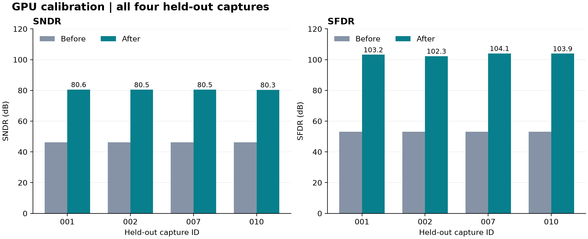

# 样例数据与验证记录

[快速上手](../docs/quick-start.zh-CN.md) · [完整教程](../docs/user-guide.zh-CN.md) · [配置参考](../docs/reference.zh-CN.md)

## 教程样例

使用 `tutorial/raw/` 中的 20 份 CSV。每份 8192 行、6 列有符号整数，无表头。全部采集放在同一目录，预处理设置 **20% 测试集比例**，由软件自动划分为 16 组训练和 4 组独立测试。

| 项目 | 条件 |
| --- | --- |
| 数据性质 | 受控流水线 ADC 仿真，无实测采集 |
| 级结构 | 5 个 2.5-bit 级和一个 4-bit 后端 |
| 名义级间增益 | 4、4、4、4、4 |
| 实际级间增益 | 3.88、4.04、3.96、4.02、4.00 |
| 信号 | 单音，1 GS/s，模拟输入峰值固定为 -3 dBFS；各采集频率和相位不同 |
| 固定误差 | 级间增益误差、比较器偏移、DAC 电平偏差和小幅三阶余量非线性 |
| 随机噪声 | 输入白高斯噪声 RMS 0.25 LSB，LSB 按 14 bit 与 ±1 V 满量程定义 |
| 未包含 | 记忆效应、抖动、温漂和跨器件变化 |

该样例用于观察系统误差的校准过程。低噪声与固定输入幅度有利于展示效果；不同幅度和实际噪声条件需要另行验证。输入 -3 dBFS 是模拟源相对 Vref 的设置，报告幅度使用程序的码字重建尺度。

[数据清单](tutorial/manifest.json)记录完整误差参数、随机种子、精确频率、相位、生成规则及每个 CSV 的 SHA-256。无需 MATLAB 即可使用数据。

## 实际验证结果

验证日期：2026-10-20；应用：**3.5.0 Windows 打包 Worker**；设备：**CUDA / NVIDIA GeForce RTX 5090 D v2**。窗口 1、隐藏层 12、grid 3、k 2、float64、种子 1、120 轮、批大小 256、学习率 0.001，余弦周期 120，目标归一化开启。其余参数与[快速上手](../docs/quick-start.zh-CN.md)一致。

在独立开发数据上确定参数后，生成本次发布数据，再运行一次自动分集、训练与测试。本次留出编号为 001, 002, 007, 010；这些采集未参加本模型训练或超参数选择。软件重新检查时会随机划分，因此读者的编号可能不同。

| 采集 | SNDR 前 | SNDR 后 | 提升 | SFDR 前 | SFDR 后 | 提升 |
| --- | ---: | ---: | ---: | ---: | ---: | ---: |
| 001 | 46.18 | 80.56 | +34.38 | 53.09 | 103.19 | +50.10 |
| 002 | 46.19 | 80.45 | +34.26 | 53.11 | 102.28 | +49.16 |
| 007 | 46.18 | 80.47 | +34.30 | 53.13 | 104.06 | +50.93 |
| 010 | 46.19 | 80.34 | +34.15 | 53.11 | 103.90 | +50.79 |

单位：dB。表中列出本次自动划分的全部 4 组独立测试采集。

[机器可读验证记录](tutorial/validation.json)包含完整精度、数据散列、分集编号、模型和训练条件。FFT 使用程序的周期 Hann 窗、8192 点和 0-500 MHz 带宽，校准前后协议一致。逐组频谱：[001](../assets/tutorial/capture_001-spectrum.svg) · [002](../assets/tutorial/capture_002-spectrum.svg) · [007](../assets/tutorial/capture_007-spectrum.svg) · [010](../assets/tutorial/capture_010-spectrum.svg)。

上述数值是此次仿真运行记录。它们不代表不同随机划分的精确结果、实际 ADC 性能、跨幅度泛化或硬件验收结论。

## 其他配套示例

| 目录 | 用途 |
| --- | --- |
| `stage-codes/raw` | 两级码字格式示例：2 列、每级 4 bit、名义增益 16 |
| `output-codes/raw` | 最终输出格式示例：1 列、14 bit、无符号十进制 |
| `pipelined` | 五组较高噪声流水线仿真，保留既有记录的复查入口 |

这些数据各有独立配置，不使用本教程的训练/测试目录设置。既有清单见[格式样例清单](manifest.json)和[流水线数据清单](pipelined/manifest.json)。

## English

Use the 20 CSV files in `tutorial/raw/` with a 20% automatic capture-level test split. The controlled six-stage simulation has fixed hardware errors, fixed -3 dBFS analog input amplitude and 0.25 LSB input noise. It has no memory, jitter or temperature variation.

The recorded packaged-Worker run used CUDA, 120 epochs and the exact quick-start settings. All four held-out captures improved SNDR by 34.15-34.38 dB and SFDR by 49.16-50.93 dB. The manifest and validation JSON provide generation parameters, hashes, split IDs, measurement protocols and all results. This is a teaching example, not a measured-hardware or cross-amplitude performance claim.
