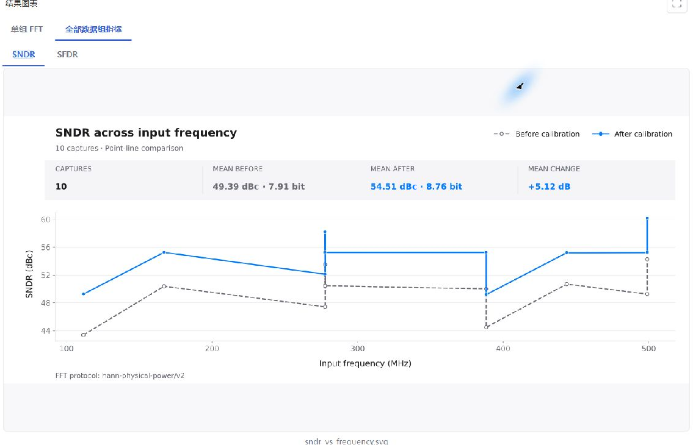

# 全频段 50 组实验记录

[快速上手](../../docs/quick-start.zh-CN.md) · [English guide](../../docs/quick-start.md) · [数据清单](manifest.json) · [完整实验记录](experiment.json)

本目录提供“流水线ADC_全频段50组”实验的原始教学数据及结果记录。应用为 Windows 版 3.5.0，记录日期为 2026-10-20。文档整理直接读取已完成项目，未重新训练、测试或调整模型。

## 数据与复现范围

`raw/` 含 50 个 CSV：10 个相干频点 × -1、-3、-6、-9、-12 dBFS 五档幅度，每文件 32768 行、6 列。采样率 1 GS/s，五个 2.5-bit 流水线级加 4-bit 后端，名义级间增益均为 4。

[MATLAB 生成脚本](generate_pipelined_single_tone.m)与示例数据一同提供。脚本已配置为 10 个频点、目标频率范围 1–499 MHz；幅度、噪声、器件误差和随机种子保留原设置。`manifest.json` 记录实际频率、相位、固定失配参数、种子，以及脚本和各 CSV 的 SHA-256。

在 MATLAB 中将当前文件夹设为本目录，运行：

```matlab
output_dir = generate_pipelined_single_tone;
```

默认输出到 `outputs/pipelined_single_tone/`，已有目录时自动另建带时间戳的目录。其中 `data/` 保存 50 个 CSV，导入 Workbench 时选择该目录；`generation.json` 和 `数据说明.txt` 保存生成参数。也可传入尚不存在的目标目录，例如 `generate_pipelined_single_tone('my_run')`。

该脚本已在 MATLAB R2025a 中重新运行，50 个 CSV 的 SHA-256 均与随附 `raw/` 数据一致。修改参数或随机种子后，生成的数据和校准结果会随之变化。脚本沿用仓库的[使用许可](../../LICENSE.txt)。

| 参数 | 数值 |
| --- | --- |
| 实际级间增益 | 3.96、4.02、3.98、4.01、4 |
| 三阶余量系数 | 1、0.5、0.2、0、0 V⁻² |
| 记忆系数 | 0.005、0.003、0.001、0、0 |
| 比较器偏移范围 | 各级 ±10、±5、±3、0、0 mV |
| DAC 电平偏差范围 | 各级 ±2、±1、±0.5、0、0 mV |
| 输入热噪声 RMS | 5 LSB = 610.3515625 μV；14-bit、±1 V 定义 |
| 模型／信号／噪声种子 | 42／1101／2101 |

## 保存的实验

- 预处理：20% 文件级留出，40 组训练、10 组测试；100% 抽样、专业、全部 IGE/DAC 开启，补偿基准为初始参数合成。
- 粗校准：39 组训练采集用于拟合，1 组训练采集用于验收。验收 ENOB 为 6.968→7.778 bit，仅对应该组，不是最终十组测试的均值。
- KAN：18→5→1，窗口 3，grid 5，k 3，identity，共 1820 参数。
- 训练：20 轮，批大小 512，学习率 0.001，AdamW/MSE，cosine 周期 20、最低学习率 10⁻⁶，权重衰减 10⁻⁴，目标标准化开启，早停关闭，种子 1。
- 运行：设备与精度请求为自动，实际解析为 CUDA、float64。完成任务为“模型训练 02”，输出版本为 v002。
- 测试：同一 best.pt，10 组 raw_test 采集，32768 点周期 Hann 窗，0–500 MHz，指标协议 hann-physical-power/v2。

`best.pt` 按训练损失选择。记录未包含独立超参数选择过程、训练/测试性能对照或新噪声重复试验，因此不据此声明模型已达最小规模或完全无过拟合。

训练与测试文件编号互斥；粗校准拟合、验收均位于训练侧。分集属于文件级留出，不保证频率或幅度条件互斥。具体编号与检查点 SHA-256 见 [experiment.json](experiment.json)，全部逐组指标见 [test-results.csv](test-results.csv)。



## English

The [MATLAB generator](generate_pipelined_single_tone.m) is included. From this directory, run `output_dir = generate_pipelined_single_tone;`. Import the generated `data/` folder into Workbench. The default output is `outputs/pipelined_single_tone/`; an existing directory is preserved by creating a timestamped directory. A rerun in MATLAB R2025a reproduced the SHA-256 hashes of all 50 supplied CSV files. The script uses the repository [license](../../LICENSE.txt).

The 50 files in `raw/` are the exact captures used by the completed experiment: ten frequencies, five amplitudes, 32768×6 signed integers each, at 1 GS/s. The saved 18→5→1 model has 1820 parameters and completed 20 CUDA/float64 epochs. All ten held-out captures are reported, with SNDR gains of 4.50–5.96 dB and SFDR gains of 20.12–28.89 dB.

Files in the training and test sets are disjoint; frequency/amplitude conditions may overlap. Coarse calibration uses training-side captures only. Its one-capture acceptance score is separate from the final ten-capture report. The record does not establish minimum model size or absence of overfitting.
