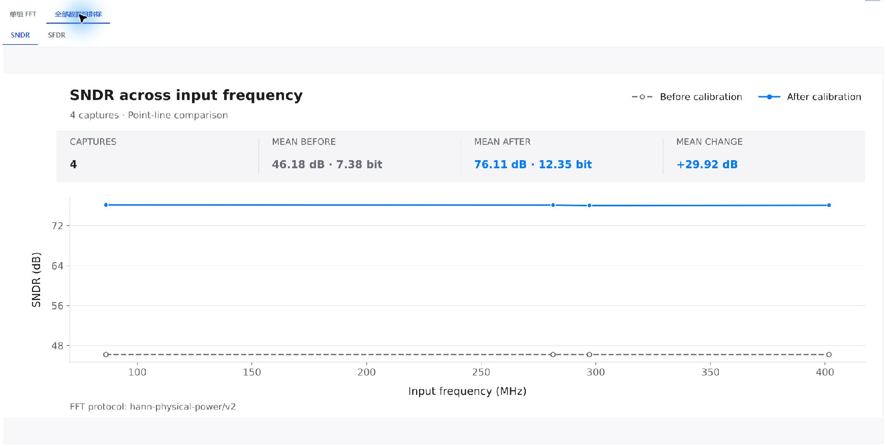
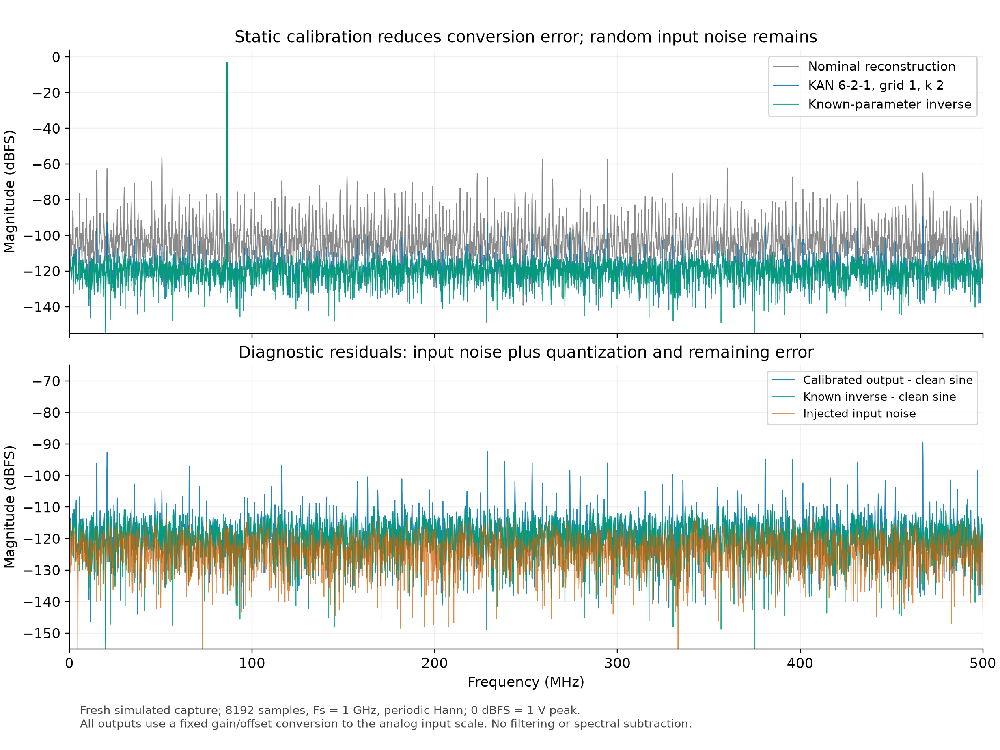

# 历史记录：r10 小模型验证与噪声核查

本文保留 r10 的 20 组低噪声实验，仅供历史复查。当前快速上手改用[全频段 50 组实验](../fullband50/README.md)，两套数据、模型与指标相互独立。
[快速上手](../../docs/quick-start.zh-CN.md) · [样例说明](../README.md) · [English quick start](../../docs/quick-start.md)

验证日期为 2026-10-20，应用为 Windows 打包版 3.5.0。教程采用 **6→2→1、窗口 1、grid 1、k 2、identity**，软件记录 **214 个参数**；相较此前 6→12→1 的 1288 个参数减少约 **83.4%**。这是本轮已验证配置中满足门槛的最小模型，不宣称全局最优或理论最小。

## 1. 数据隔离与选择规则

公开数据共 20 份，每份 8192 点，来自同一个固定误差 ADC、同一 -3 dBFS 幅度。使用已完成预处理的固定分集：

| 用途 | 采集编号 | 如何使用 |
| --- | --- | --- |
| 训练侧拟合，12 组 | 001、004、005、007、008、010、011、014、015、018、019、020 | 比较结构时更新参数 |
| 训练侧验证，4 组 | 002、003、016、017 | 选择结构与网格，不更新候选模型参数 |
| 最终测试，4 组 | 006、009、012、013 | 小模型方案固定后报告结果，不参与本轮调参 |

训练侧验证划分使用种子 20261020，从外层 16 个训练文件中抽取。初轮先从一个隐藏节点开始，逐步增加表达能力；两个节点通过后，再检查更小网格。所有候选固定 120 轮、种子 1、CUDA/float64、批大小 256、AdamW、学习率 0.001、权重衰减 0.0001、cosine 周期 120、最低学习率 0.000001，目标标准化开启、早停关闭。

预先设定的门槛是：**每一个训练侧验证采集的 SNDR 和 SFDR 均至少提升 25 dB**。初轮成功后的小网格复查使用同一门槛；下表列出全部实际运行的六个候选，按软件参数数排序。

| 结构 | grid / k | 参数数 | 最低 SNDR 提升 | 最低 SFDR 提升 | 结论 |
| --- | --- | ---: | ---: | ---: | --- |
| 6→1→1 | 1 / 1 | 106 | 10.57 | 8.98 | 未通过 |
| 6→1→1 | 1 / 2 | 127 | 10.84 | 8.97 | 未通过 |
| 6→1→1 | 2 / 2 | 141 | 13.10 | 10.78 | 未通过 |
| 6→1→1 | 3 / 2 | 155 | 12.36 | 9.10 | 未通过 |
| 6→2→1 | 1 / 2 | 214 | 29.81 | 32.89 | 通过，采用 |
| 6→2→1 | 3 / 2 | 258 | 34.20 | 49.12 | 通过，参数更多 |

提升单位为 dB。一个节点的已测方案未达到门槛；214 参数方案通过后即固定，没有用最终四组结果回调网络或训练轮数。原计划中的更大候选未执行。选择过程与全部逐组指标见 [model-selection.json](model-selection.json)。

固定配置后，在 GUI 中合并训练侧的 12+4 组、使用全部 **16 组重新训练**，再测试外层四组。`best.pt` 按最低训练损失保存；程序当前的这个入口没有独立验证损失早停，因此教程没有将它描述为验证集选模。四组外层测试的原始文件、模型输入、基准及参考均没有进入本次训练配置。

这些是已公开、曾用于其他模型演示的教学数据，不是算法开发意义上的盲测数据。本次隔离可以核查固定配置在未参与本次拟合的采集上是否有效；若据此开发算法，应另保留新采集用于最终评估。

## 2. GUI 最终测试与过拟合检查

界面操作完成了数据检查、预处理、训练 120/120 轮与四组模型测试；实际设备为 NVIDIA GeForce RTX 5090 D v2、CUDA、float64。完整配置、原始数据散列、分集、检查点散列及 FFT 协议见 [walkthrough-validation.json](walkthrough-validation.json)。

| 采集 | SNDR 前 | SNDR 后 | 提升 | SFDR 前 | SFDR 后 | 提升 |
| --- | ---: | ---: | ---: | ---: | ---: | ---: |
| 006 | 46.19 | 76.15 | +29.97 | 53.13 | 86.13 | +33.00 |
| 012 | 46.19 | 76.13 | +29.94 | 53.08 | 86.51 | +33.43 |
| 013 | 46.18 | 76.05 | +29.86 | 53.09 | 86.39 | +33.29 |
| 009 | 46.18 | 76.10 | +29.92 | 53.03 | 86.16 | +33.13 |

单位为 dB，四组全部列出。校准前后均使用 8192 点周期 Hann 窗、1 GS/s、0–500 MHz 带宽和 `hann-physical-power/v2` 指标协议；没有改变带宽以获得改善。

在同一冻结检查点上，额外计算全部训练采集与测试采集的 SNDR，仅作诊断，不再调参：

| 数据角色 | 组数 | 平均 SNDR | SNDR 范围 |
| --- | ---: | ---: | --- |
| 最终训练集 | 16 | 76.04 dB | 75.94–76.14 dB |
| 最终测试集 | 4 | 76.11 dB | 76.05–76.15 dB |

训练均值减测试均值为 **-0.063 dB**，没有观察到明显训练优势。低容量模型、完整采集隔离和下述新噪声对照共同降低了记住训练样本的疑虑；四组同分布测试不能证明所有工况都不存在过拟合。逐组诊断见 [generalization-diagnostic.json](generalization-diagnostic.json)。

## 3. 理论参照保留什么

根据 [manifest.json](manifest.json) 中的误差参数、相位和噪声种子，重新计算全部 20 份采集，所得六列码字与公开 CSV **逐点完全一致**。已知参数反演按以下顺序计算：

1. 以 4-bit 后端码字对应的量化区间中点估计末级余量。
2. 从最后一个流水线级向前，求解已知的 `余量 = 增益 × 差值 + 三阶系数 × 差值³`。
3. 加回该级码字对应的 DAC 电平和固定偏差，回到模拟输入尺度。

它能校正已知静态误差，但无法知道被输入噪声扰动前的真实瞬时电压，也无法消除后端量化误差。比较器偏移影响码字决策过程；反演使用实际输出的码字路径。该对照不是无噪声正弦，也不作为模型训练标签。

这张图使用额外生成的 8192 点、频率 bin 707、相位 0.273、噪声种子 941702 的采集，未用于训练或选模。为比较物理噪声，所有输出只经过固定增益与直流偏置换算，统一到 **1 V 峰值为 0 dBFS** 的模拟输入尺度。上图是原始 FFT 曲线，下图只减去已知无噪声正弦以展示残差；没有平滑、滤波、噪声扣除或按频点缩放。完整图形协议见 [spectrum-provenance.json](spectrum-provenance.json)。

软件实际测试图使用码字重建尺度，所以本例基波约为 -5.48 dBFS；模拟源和物理参照为 -3 dBFS。两张图的绝对纵轴不能跨图直接相减，SNDR/SFDR 应在各自一致的定义下比较。

## 4. 独立噪声对照

使用种子 941701，在 ±10^(-3/20) V 范围抽取 **262,144 个独立模拟输入工作点**；每个点分别加入两份独立高斯噪声，再通过同一 ADC 和固定模型。输入噪声 RMS 为 **30.52 µV**。对于每条转换曲线，先估计一个固定线性增益，两次噪声实现共用该增益；不做时域滤波。

定义 `Δn = n₁ - n₂`、`Δy = (y₁ - y₂) / 固定增益`：

- 线性噪声传递系数为 `Σ(Δy × Δn) / Σ(Δn²)`，约 1 表明输入扰动被保留。
- 成对输出随机 RMS 为 `std(Δy) / √2`，同时包括噪声触发的量化与码字转换差异。
- 表中倍数为 `std(Δy) / std(Δn)`，不等同于只含输入噪声的传递系数。

| 输出 | 噪声传递系数 | 成对输出 RMS（µV） | 相对输入噪声 RMS |
| --- | ---: | ---: | ---: |
| 名义参数合成 | 1.0010 | 82.62 | 2.699 |
| 214 参数 KAN | 1.0009 | 46.71 | 1.526 |
| 已知参数反演 | 1.0012 | 46.65 | 1.524 |

KAN 的输入噪声传递系数为 **1.0009**，随机输出仍高于原始输入噪声，并接近保留量化误差的已知参数反演。图中校准前较高的“底部”还含码字重建误差和错误码字间距引入的扰动，不能全部当作不可校准的模拟白噪声。因此应表述为**静态转换误差得到校正，输入随机噪声没有消失**。详见 [noise-diagnostic.json](noise-diagnostic.json)。

本核查限于该固定幅度、固定器件仿真；跨幅度、温度、器件、抖动与记忆效应均需另外采集数据检验。

## 5. 可复查材料

- [数据清单与 CSV 散列](manifest.json)
- [结构选择记录](model-selection.json)、[最终 GUI 运行](walkthrough-validation.json)、[训练/测试诊断](generalization-diagnostic.json)
- [噪声诊断](noise-diagnostic.json)、[频谱来源与定义](spectrum-provenance.json)
- 软件导出原始 SVG：[006](../../assets/tutorial-walkthrough/capture_006-spectrum.svg)、[012](../../assets/tutorial-walkthrough/capture_012-spectrum.svg)、[013](../../assets/tutorial-walkthrough/capture_013-spectrum.svg)、[009](../../assets/tutorial-walkthrough/capture_009-spectrum.svg)
- [物理参照 SVG](../../assets/tutorial-walkthrough/noise-reference.svg)

本页只公开教学数据、参数、测量结果与截图。应用许可证和源码保护范围不变。
